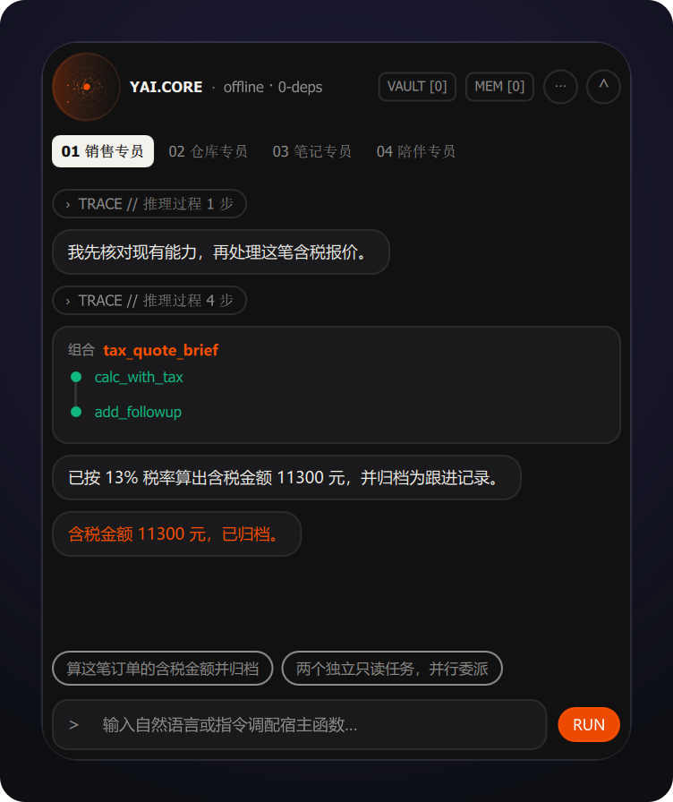
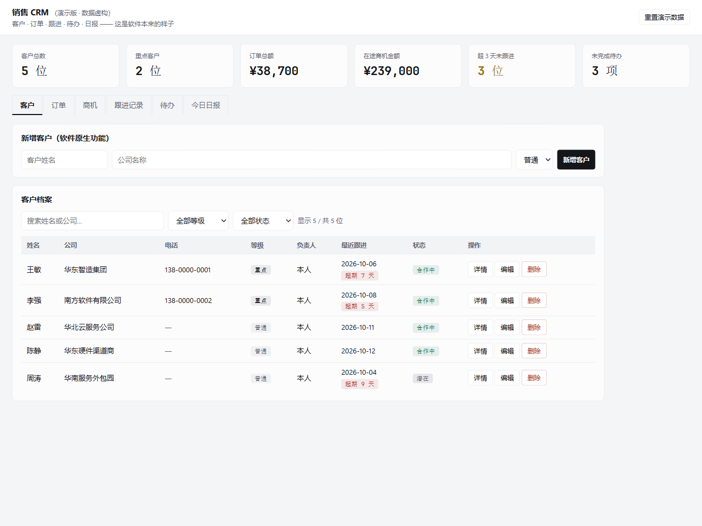
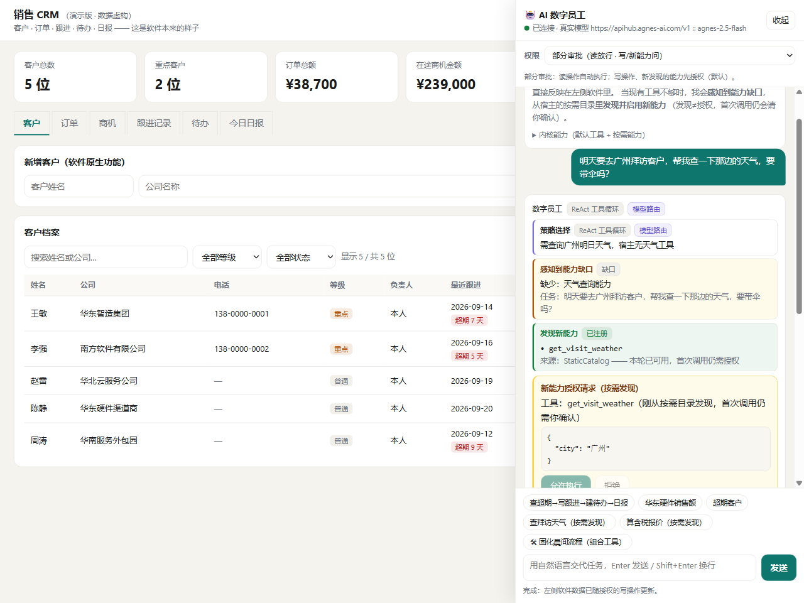
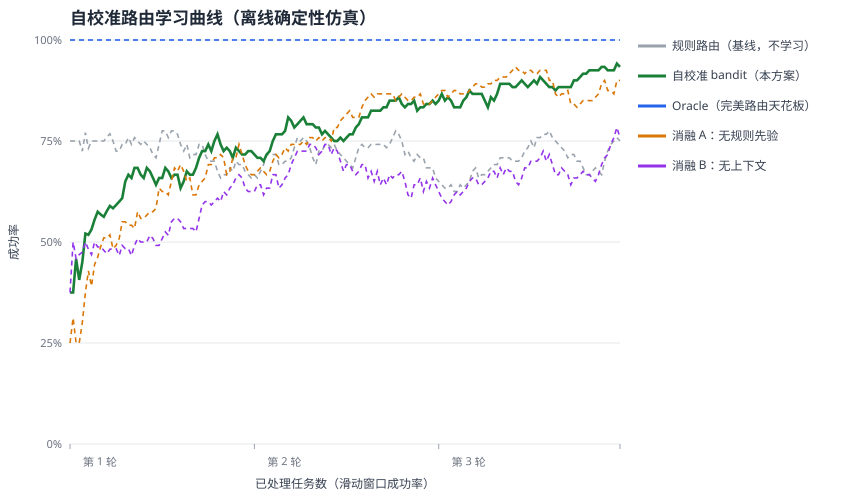

# YAI Agent Core

**English** · [简体中文](README.md) · [Documentation site](https://gi-tuu.github.io/yai-agent-core/) · [English docs](https://gi-tuu.github.io/yai-agent-core/index.en/)

[](https://github.com/Gi-Tuu/yai-agent-core/actions/workflows/ci.yml)
[](https://scorecard.dev/viewer/?uri=github.com/Gi-Tuu/yai-agent-core)
[](https://www.bestpractices.dev/projects/15360)
[](https://agentrank-ai.com/tool/Gi-Tuu--yai-agent-core/?utm_source=badge&utm_medium=readme&utm_campaign=agentrank_badge)
[](LICENSE)
[](https://www.python.org/downloads/)
[](CHANGELOG.md)
[](pyproject.toml)

<p align="center"><b>Give every piece of software a thinking heart.</b></p>

> An in-process, embeddable, **self-adaptive** Agent kernel — the **SQLite of the agent world**.
> You don't deploy an agent platform, and you don't write an Agent Loop / Planner / tool-selection layer:
> `import` the kernel into the software you **already have**. The host only declares *what capabilities it
> has*; Core discovers them, picks a strategy, calls tools, and finishes the task.

<p align="center">
  
</p>

<p align="center"><b>One floating window is one digital employee.</b> Chat is the main surface; the reasoning
chain and tool calls collapse into "Process · N steps". Routing, capability gaps, newly discovered tools
flying in, and approval cards are all driven by real kernel events. All data shown is fictional.</p>

<p align="center">
  
</p>

<p align="center"><b>27 seconds, end to end</b>: CopilotKit chat → AG-UI events (including TOOL_CALL_*) → a Box cloud desktop driven over MCP.</p>

## Running in 30 seconds

Install the package and verify embedding with zero API key — the kernel itself has zero third-party hard
dependencies:

```bash
pip install yai-agent-core
```

```python
import asyncio
from yai_core import AgentCore, ScriptedModel, ModelResponse, ToolCallRequest, build_spec

def search_notes(keyword: str) -> list[str]:
    """Search the host's note database."""   # your own ordinary business function — no agent code
    return {"weekly-report": ["Core skeleton", "tool calls"]}.get(keyword, [])

# Offline deterministic model (swap for OpenAICompatProvider in production): calls the tool, then concludes.
model = ScriptedModel([
    ModelResponse(content="", tool_calls=[ToolCallRequest(id="c1", name="search_notes",
                 arguments={"keyword": "weekly-report"})]),
    ModelResponse(content="2 items in the weekly report."),
])
core = AgentCore(model)
core.register_tools([build_spec(search_notes)])      # introspects type hints / docstring into a tool schema
print(asyncio.run(core.run("Search the weekly report and summarize")).final_text)
```

A fuller version (two tools + event stream, ~100 lines) lives in the repo and shows the kernel making the
routing decisions for you:

```bash
python examples/quickstart.py
# tools (introspected): ['search_notes', 'archive_note']
# [route] react
# [tool] search_notes({'keyword': '周报'})
# [tool] archive_note({'title': 'Core 骨架'})
# [done] 本周周报 3 条，已归档「Core 骨架」。
```

Using a real model is a one-line change (`[llm]` extra; OpenAI-compatible DeepSeek / Qwen / OpenAI / Agnes):

```python
from yai_core import OpenAICompatProvider
model = OpenAICompatProvider()      # reads OPENAI_API_KEY / OPENAI_BASE_URL / LLM_MODEL
```

For Claude-family models use the `[anthropic]` extra (same `ModelProvider` contract; the Messages-API
translation lives entirely in the adapter):

```python
from yai_core import AnthropicProvider
model = AnthropicProvider()         # reads ANTHROPIC_API_KEY / ANTHROPIC_MODEL / ANTHROPIC_STRONG_MODEL
```

> The first run prints a `ProductionSafetyWarning`: the kernel is reminding you to declare an explicit
> permission policy in production. The example keeps the permissive default so it runs in 30 seconds; see
> [`docs/guides/production-permissions.md`](docs/guides/production-permissions.md).

**Run every host and every test** (clone the repo; offline, no key needed):

```bash
uv venv
uv pip install -e ".[dev,llm,server]"
uv run python scripts/smoke_test.py           # one Core adapting to several different hosts
uv run python scripts/demo_governance_loop.py # the whole governance loop: request → approval → execute → trace
uv run python scripts/check_all.py            # every local gate: lint / types / tests / coverage / smoke
```

New to the code? [`docs/reading-guide.md`](docs/reading-guide.md) is the learning path (zh-CN) and
[`docs/walkthrough/00-index.md`](docs/walkthrough/00-index.md) is the line-by-line walkthrough (zh-CN).
[`docs/IMPLEMENTATION_STATUS.md`](docs/IMPLEMENTATION_STATUS.md) is the capability/evidence index
(verified · implemented but not machine-verified · explicitly not done);
[`docs/DOCUMENT_MAP.md`](docs/DOCUMENT_MAP.md) is the full document map.
For architecture in English see [`docs/architecture.en.md`](docs/architecture.en.md) and
[`docs/comparison.en.md`](docs/comparison.en.md).

## What is this

YAI is not another chatbot, nor an agent framework you assemble by following a tutorial. It is a **kernel
that runs inside your software's process**:

- You hand it the **ordinary functions that already exist** in your software (or connect MCP / OpenAPI);
- It introspects those capabilities, auto-generates tool specs, and on each task **adaptively** decides
  whether to answer directly, call a tool, plan in steps, or ask you for clarification;
- When capabilities are insufficient it **senses the gap and discovers new tools on demand**;
  **operations covered by a host-declared approval policy** request authorization first (the default
  policy allows everything — tighten it with `auto_approve_tools=False` or the `PermissionPolicy`
  SPI) — and every step is visible as an event.

## Who it is / isn't for

| ✅ Good fit if you… | ⛔ Not a fit if you… |
|---|---|
| Already have working software and want to **add agent capability cheaply**, without platform lock-in | Want to **drag-and-drop agents** in a browser with no code (use a visual agent platform) |
| Want AI to call your software's **real functions**, not generic chit-chat | Want an out-of-the-box **cloud-hosted / team SaaS** agent |
| Need a **self-hostable, embeddable** agent runtime with swappable parts | Want an unattended, fully autonomous **coding agent** (YAI's approval gate is driven by host declarations and can be tightened as needed) |
| Want to learn agent internals by building (auditable decisions, line-by-line walkthrough) | Expect a zero-config generic assistant — YAI's value is precisely in **binding to host capabilities** |

## How it differs from what you've heard of

|  | Platforms<br>visual agent platforms | Frameworks<br>orchestration · multi-agent frameworks | **Embedded kernel · YAI** |
|---|---|---|---|
| Form | Sign up, build inside the platform | Define agents / tools / orchestration yourself | **`import` into existing software** |
| Agent code you write | — | A lot | **No Agent Loop / Planner / tool selection** (just your business functions and declarations) |
| Deployment | Hosted by the platform | Run a service yourself | **Lives in the host process; no separate service** |
| Binding host capabilities | Ready-made integrations / plugins come first; host-private capabilities usually need your own wiring | Manual wiring | **Automatic introspection & discovery** |
| Hard third-party kernel deps | — | Usually many | **0** (all optional, lazily loaded) |

> Database analogy: platforms are cloud database consoles, frameworks are ORMs, **YAI is SQLite** — it never
> steals the spotlight; it quietly embeds into your program.

## Core capabilities

| Capability | In one line |
|---|---|
| **Capability auto-discovery** | Python type hints + docstrings auto-generate JSON Schema; external **MCP** tools (via MCP Client, with 2026-07 stateless support / auth headers / remote-description sanitization) and **OpenAPI 3.0/3.1** REST operations (via spec parsing) register the same way |
| **Adaptive routing** | Tasks route to `direct / react / plan / clarify`; LLM classification falls back to rules on error; insufficient tools emit `capability_missing`; every decision is auditable |
| **Self-calibrating learning** | A contextual bandit learns routing from success/failure and picks strategies via Thompson Sampling; offline benchmark reaches **89.6% vs 73.3% for rules (~+16pp)** in late rounds (off by default: `learning=None`) |
| **On-demand discovery loop** | Gap → ask discovery sources for candidates → register → **callable within the same turn**; dual-channel recall (lexical + local bge-m3 / cloud embeddings), and remote MCP/OpenAPI sources are conservatively narrowed by the gap too (fall back to all on no hit) (off by default: without a discovery source there is no `request_capability`) |
| **Long-context compaction** | Over budget, old turns are summarized while recent turns stay intact; on model failure it falls back to hard truncation — long conversations keep early goals and facts (off by default: `context_compaction=False`) |
| **Dynamic re-planning** | When a multi-step plan turns out unworkable mid-execution, the model calls `replan` to explicitly return to planning, keeping completed steps and producing a revised plan (`plan_revised`); registered only for PLAN, it only rearranges the internal plan with no side effects and no approval gate |
| **Cost-aware tiering** | Defaults to the cheap/fast `standard` tier and only escalates to `strong` for planning, failure-recovery, or being stuck in late rounds; tiering is deterministic and costs no extra call; DONE summarizes per-tier call counts; disable with `cost_aware=False` |
| **Structured long-term memory** | `remember` / `recall` proactively store and retrieve facts / preferences / profiles; near-duplicate merge, importance weighting, JSON persistence; **batch writes + incremental inverted index, 10k-scale build now runs**; no built-in vector memory — semantic recall goes through the Embedding SPI (off by default: `long_memory=False`) |
| **Live host state (current-state anchor)** | The host registers read-only snapshot callbacks; before every model call the kernel injects the *current* UI/business state as a transient system block — never written to history, compaction or long-term memory; per-provider and total caps apply, and a failing provider only degrades with a diagnostic |
| **Language-agnostic hosts (Sidecar)** | `python -m yai_core.sidecar` carries the agent session over stdio NDJSON + JSON-RPC 2.0: initialize, run, cancel, approvals/clarifications and the event stream; host tools still come in via MCP/OpenAPI — no second tool-call channel; a **typed Node/TS client** lives in `clients/node/` |
| **Multimodal messages (optional)** | `ChatMessage.parts` carries text / image / resource-reference parts: **off by default** (plain-text messages serialize byte-identically); only an inlined image is actually visible to the model, while a reference renders as an explicit "the model cannot see this" placeholder (never silently dropped), and persistence stores references only — never image bytes |
| **Safety boundaries** | Three permission tiers (approve-all / partial / no-approval); **argument-level approval** (hosts write data to say "ask a human above this line"); composed tools only orchestrate registered tools and never run generated code; code generation defines only the `ToolSandbox` contract — the sandbox is host-provided |
| **Declarations become constraints** | Execution hints from an external capability contract are **really enforced**: call timeout, rate limit (over-limit calls never reach the handler) and trusted-subject requirement (no subject, no call) are all enforced by the executor; governance comes only from the declaration registered with the tool, never from model arguments |
| **Sub-employee delegation** | The root employee can hand narrowed subtasks to short-lived sub-employees: tool allowlist ⊆ root, monotonically narrower permissions, an isolated small context, per-task budget and a global concurrency gate (≤5 in parallel, ≤2 levels deep); results flow back only to the root and the sub-employee is destroyed when done. The Dynamic Island switches between several mutually isolated specialists |
| **Parent-child cores (directed federation)** | Host-layer module: a core in the parent product registers tools declared by the child product's core as its own (parent → child only; the child has no path back); grants limit the tool subset / subject / expiry, with depth ≤3, fan-out, cycle detection and failure isolation; supports local IPC, manifest hot-update, per-edge quota/stats and managed child processes; app objects become child cores in one call, with cross-core usage aggregation (`max_tokens` fails closed) |
| **Fully observable** | Every strategy choice, capability gap, tool discovery/composition/call, and permission confirmation is emitted through one unified event stream |
| **Structured tracing** | The optional `[otel]` extra subscribes to the event stream from the outside and turns a run into one OpenTelemetry trace: a root span with a child span per tool (ok/error/duration) and adaptive decisions as span events; it never touches the kernel and never initializes an exporter — wiring Jaeger / Tempo / OTLP is the host's decision |
| **End-to-end evaluation** | A built-in offline eval harness runs the full Core with a ScriptedModel, quantifying completion rate, tool precision/recall, overreach and unsupported claims; golden regression baseline + non-blocking CI |

<details>
<summary>Show: the ten swappable SPI contracts</summary>

`Model · Channel · Memory · Policy · Discovery · Sandbox · RouteSelector · Embedding · StorageCipher · Resource`
— the host can replace any of them; Core provides zero-config defaults (`StorageCipher` is the optional
at-rest encryption slot; `Resource` is the file/resource slot — the kernel never touches disk itself, the
built-in implementation lives in `batteries/filesystem.py`). The kernel itself always has zero third-party
hard dependencies.

</details>

## Two ways to use it

### 1) Embed as a library (three steps)

```python
from yai_core import AgentCore, OpenAICompatProvider
import my_app_capabilities as cap                       # the host's own ordinary business functions

core = AgentCore.auto(cap, OpenAICompatProvider())      # ① introspect capabilities, auto-register tools
result = await core.run("Search this week's records and compile a report")  # ② adaptive direct/react/plan/clarify
print(result.final_text)                                # ③ deliverable result + full event trace
```

### 2) The Dynamic Island employee thin shell (`shell/desktop`)

Hosts that want a "face" **don't have to write their own chat window**: the official thin shell provides a
persistent floating window, rendered natively with Qt Quick, running in the **same process** as the Core
embedded in each app (no local port).

<p align="left">
  
</p>

- **Three-state morphing**: round ball (52px) → on hover expands right into a capsule (440×52) → on click
  expands down into the employee panel (440×536); draggable throughout;
- **Position memory**: after dragging, closing and reopening returns the window to where it was;
- **First-run guide**: a "click me" hint + four-state orange nebula, shown once and never again;
- **Global hotkey**: press `Ctrl+Alt+Y` in any application to summon and expand it instantly;
- **Offline / live dual entry**: desktop shortcuts start either the offline demo or the live-model employee;
- **Multi-specialist switching**: one island manages several **isolated** specialists — sales / warehouse /
  notes / companion — without losing timelines. The island is only the front desk / switchboard, **not a
  super-agent**;
- **Cross-core call visualization**: when a specialist acts as a parent core calling a child core (tool
  names of the form `prefix__tool`), the panel shows a `CROSS-CORE` summary (calls / failures / tokens)
  below the specialist bar, turning red on failures; the aggregation is Qt-free and unit-tested offline.

```bash
uv sync --extra desktop --extra llm
.\.venv\Scripts\python.exe -m shell.desktop            # offline demo: all animations, no API key
.\.venv\Scripts\python.exe -m shell.desktop --live     # connect a real model
```

The shell only renders and orchestrates. `shell/employee` implements sub-workers as one-shot sub-runs with
"narrowed tools + narrowed permissions + isolated context + a budget" (≤ 5 in parallel, ≤ 2 levels deep,
results flow back only to the root); **the kernel knows nothing about the UI and is not a multi-agent
framework**.

## Screenshots

<p align="center">
  
  &nbsp;&nbsp;
  
</p>

<p align="center"><b>Left:</b> the app as it naturally is (six native views, fully usable without Core);
<b>right:</b> after embedding Core, it discovers tools when capabilities are short, and still shows an
approval card on first call (discovery ≠ authorization) — here host_e **explicitly declared an approval
policy**; the kernel's default policy allows everything.</p>

<p align="center">
  
</p>

## Examples (from simplest to deepest)

| # | Host | What to see |
|---|---|---|
| 1 | `host_a_notes` | Minimal integration: ordinary functions become tools automatically |
| 2 | `host_c_companion` | Changing domain = changing job (an AMBRACE rehearsal) |
| 3 | `host_d_mcp` | Connecting to an external MCP Server as a Client |
| 4 | `host_f_discovery` | Capability gap → discovery → usable this turn (static / semantic) |
| 5 | `host_g_sandbox` | Teaching sandbox: build and run a code tool on the spot |
| 6 | `host_e_sales_crm` | Flagship: a standalone CRM that embeds Core with one switch (terminal + web, port 8200) |
| 7 | `host_i_mealie` | Adapting a real third-party open-source project over REST (Mealie) |
| 8 | `host_j_actual` | Third-party seeding "five-beat" line in the Actual Budget ledger app (discover a missing tool / delegate sub-employees; web on 8240) |
| 9 | `host_k_multimodal` | Multimodal: the model only picks an image handle; the host resolves it and enforces scope / expiry / size |
| 10 | `host_l_sidecar_node` | Language-agnostic host: Node spawns the sidecar, exposes tools via its own OpenAPI service, and answers approval requests |
| 11 | `host_m_federation` | Parent-child cores Phase 1/2: an ATM parent core asks a document child core to record a transaction; `run.py` (in-process) + `ipc_demo.py` (two processes, local IPC, no key) |
| 12 | `child_cores` | Two installable child cores (notes / calculator) + `hub_demo.py`: one parent supervises both child processes and calls across them |
| 13 | `host_ag_ui_sse` | AG-UI 1.0 SSE host: FastAPI translates YAI's event stream into the standard frontend protocol |
| 14 | `host_ag_ui_copilotkit` | Real CopilotKit v2 frontend: Runtime → HttpAgent → YAI `/agent` (with a tool call + npm build CI) |
| 15 | `host_box_mcp` | Box by Simular cloud desktop: MCP exposes 36 shell/browser/computer tools (real-machine smoke) |
| 16 | `host_mcp_registry` | Official MCP Registry read-only discovery: search + explicit config (no auto-install/connect) |

> Directory names keep their historical letters (a/c/d/e/f/g/i/j/k/l) and are not reordered by learning
> sequence, so they stay consistent with the docs and walkthrough paths.

## HTTP API (optional, self-hosted)

The FastAPI Battery exposes the endpoints below; deployment options (Docker / Render Blueprint /
VPS + Caddy) are covered in [`docs/guides/demo-deployment.md`](docs/guides/demo-deployment.md) (in Chinese).

```bash
GET  /health                  # {"status":"ok", ...}
GET  /v1/tools                # the tool list the current host auto-discovered
POST /v1/agent/run            # {"task": "..."} -> event stream + final result
```

For optional environment variables (persistent memory, history trimming / TTL, rate limiting) see
[`.env.example`](.env.example) and [`docs/architecture.en.md`](docs/architecture.en.md).
Prebuilt self-hosted image: `ghcr.io/gi-tuu/yai-agent-core:latest` (built on tag pushes, see
[`docs/guides/demo-deployment.md`](docs/guides/demo-deployment.md)).

## Version roadmap

- **v0.1 – v0.3 (done)**: function introspection, rules/LLM routing, Agent Loop, default SPI
  implementations, MCP Client, SQLite persistence, OpenAPI discovery, history trimming & rate limiting,
  containerized deployment
- **v0.4 – v0.6 (done)**: capability-gap sensing and the ToolDiscovery loop, zero-change embedding of the
  host_e CRM, three permission tiers, composed tools, dual-channel semantic discovery, in-execution
  discovery
- **v0.7 (done)**: contextual-bandit self-calibrating router (+16pp offline), code-tool
  registration/TTL/approval gate, subprocess teaching sandbox, the Dynamic Island employee shell
- **v0.8 (done)**: context compaction; MCP/OpenAPI dynamic discovery sources with multi-source
  aggregation; SQLite KV TTL; Docker sandbox adapter; API-key auth, rate limiting and response guards;
  published to PyPI; CI hardening (CodeQL, OpenSSF Scorecard, mypy, coverage gate)
- **v0.9 (done)**: dynamic re-planning `replan` and cost/latency-aware `tiering`
  (automatic standard/strong shifting + DONE cost summary); semantic recall of long-term memory with
  proactive recall at task start, and the 9th SPI `StorageCipher` for at-rest encryption; structured
  OpenTelemetry tracing, metrics/readiness and a task-level budget circuit breaker; sub-employee budget
  and a global concurrency gate; and the third-party seeding five-beat line (`host_j` embeds into the
  real bookkeeping app Actual Budget with zero source changes)
- **v0.10 (done)**: governance declarations travel across processes with the capability manifest; hard
  tool timeout `tool_timeout` and unified `aclose` teardown; Anthropic model backend; the 10th SPI
  `ResourceProvider`; ACC compatibility layer; approval/execution/audit from one parameter snapshot plus
  declarative redaction; a global rate-limit backstop
- **v0.11 (done)**: native parameter-level approval (ACC demoted to an interop shim); `risk` / `scope`
  emitted with events; resource-scope gate `filesystem_gate`; PEP 563 annotation resolution fix
- **v0.12 (done)**: eight "looks guarded, actually silent" security fixes; ACC execution hints really
  enforced by the executor; multimodal message contract `ChatMessage.parts`; manifest
  `manifest_version` bumped to 2; a critical certifi vulnerability fix
- **v0.13 (done)**: input-schema subset expanded from 4 to 13 keywords; three multimodal follow-throughs
  (true cost accounting / capability probing / the `host_k` sample); composite workflow version store;
  cross-layer adversarial evidence; POSIX `O_NOFOLLOW` narrows the symlink race window
- **v0.14 (done)**: execution constraints applied on every path; input validation as a
  common floor for all calls; `strict_direct` mode; `capability_health()` checks; trusted change preview
  `ChangePreview`; execution receipts and in-process idempotency
- **v0.15 (done)**: live host state (current-state anchor) injection; execution-governance hardening
  (idempotent replays no longer bypass tightened permissions, preview tokens narrowed to the relevant
  state); the router benchmark's holdout / frozen-learning evaluation wired into CI
- **v0.16 (done)**: language-agnostic host access through the Sidecar session control protocol
  (stdio NDJSON + JSON-RPC 2.0; the tool surface still goes through MCP / OpenAPI)
- **v0.17 (done)**: a zero-dependency Node host really spawns the sidecar; CI exercises the real
  MCP / stdio path; the companion host registers a state provider
- **v0.18 (done)**: the desktop companion specialist joins HostStateProvider, with the current-state
  anchor verified against the real live factory
- **v0.19 (done)**: the sales CRM's "currently selected customer" joins HostStateProvider, with the
  web app and the desktop reading the same state across processes
- **v0.20 (done)**: desktop shell visual rework (Optical Obsidian / Braun Signal Orange), with the
  orb / capsule / panel sharing the four-state nebula
- **v0.21.0 (done)**: the Office document text-extraction battery (zero-dependency
  docx / xlsx / pptx; PDF via an optional extra); the desktop nebula motion aligned with the design
  draft (integrated by real dt, fixing the drift speed)
- **v0.22.0 (done)**: a full audit remediation batch — red line 1 (zero third-party
  hard dependencies in the kernel) now has a whole-tree guard test, `CODE_TOOL_RETIRED` became a real
  event instead of a dead one, the sdist's bundled test suite went from 21 collection errors to 0
  (full suite exits 0 from the unpacked package), dependency CVEs are cleared, and every
  Chinese/English facade's facts and wording were reconciled
- **v0.22.1 (done)**: the second audit remediation batch — tighter execution
  semantics (malformed tool JSON rejected at the parse boundary, idempotent replays re-check their
  permission dependencies, composite tools hand the remaining timeout budget to each step), fixes to
  context ordering / replanning / closed-core behaviour, atomic SQLite backup and restore, per-layer
  worker permissions, **a real fix for external cancellation being swallowed by `asyncio.wait_for`
  on Python 3.11**, and 12 → 0 broken links inside the sdist; Releases now upload provenance assets
- **v0.23.0 (done)**: making "verifiable on the spot" part of the repo — `demo_governance_loop.py` runs the whole governance loop in one command, `check_all.py` runs every gate in one command, and `docs/IMPLEMENTATION_STATUS.md` indexes capabilities against evidence; the desktop nebula's particle count is now configurable (`ui/nebulaParticles`, default 260)
- **v0.25.0 (done)**: production-readiness batch — 8-finding hardening, egress boundaries, secure defaults, sidecar identity pinning, AgentDojo repeat sampling & multi-attack, production host example; v0.24.0 brought trust in three layers — prompt caching (Anthropic input cost), tool output treated as untrusted data with an offline injection regression suite, execution-receipt hash chaining and **permission denials as visible events**; plus parallel compaction and a task anchor for long sessions
- **v0.46.0 (done, current release)**: read-only MCP Registry discovery (search + explicit config) and an A2A 1.0 positioning document (no Multi-Agent in the kernel)
- **v0.45.1 (done)**: English changelog, one-line English summaries for all 44 release notes, and an English document map
- **v0.45.0 (done)**: LoCoMo scoring upgrades (temporal F1 0.387 / LLM judge 0.424)
- **v0.44.0 (done)**: LoCoMo end-to-end memory QA (BGE-M3 + real model; answerable F1 0.348 / EM 0.193)
- **v0.43.0 (done)**: LoCoMo lexical vs BGE-M3 semantic comparison (R@5 0.3482 → 0.5067; hybrid MRR 0.4361)
- **v0.42.3 (done)**: a 27-second demo GIF (CopilotKit → AG-UI events → Box cloud desktop) + a Box real-machine screenshot
- **v0.42.2 (done)**: a real tool call in the CopilotKit demo + npm build CI (`npm ci` / `npm run build`)
- **v0.42.1 (done)**: Box computer-use acceptance A–D (read screen / GUI typing / browser write / cleanup, all PASS on real machine)
- **v0.42.0 (done)**: **Box by Simular real-machine integration** (36 MCP tools: cloud shell / Chrome / computer; verified `absent → running → shell → example.com`)
- **v0.41.0 (done)**: a **real CopilotKit v2 frontend demo** (CopilotKit Runtime → HttpAgent → YAI `/agent`, AG-UI SSE verified end-to-end, with screenshots)
- **v0.40.0 (done)**: a LoCoMo-style offline memory benchmark (10 conversations / 1,973 QA, lexical Recall@5 0.3482 / MRR 0.2927) with synthetic-fixture regressions; dataset not redistributed
- **v0.39.0 (done)**: an AG-UI 1.0 adapter (event stream → SSE standard frontend protocol) plus a FastAPI example, bilingual guide and 10 offline regressions
- **v0.38.0 (done)**: MCP 2026-07-28 stateless compatibility, URL auth (`headers` / `token_env`), and tool-description poisoning defenses (remote-description sanitization / `trust_tool_descriptions=False`), verified by a real local stateless-HTTP regression
- **v0.37.0 (done)**: a good-first-issue claiming flow (`claimed` label + issue template), 30 bilingual documentation pairs with guard tests, and an offline OpenAPI 3.1 example (community contribution)
- **v0.36.0 (done)**: machine-readable smoke results via `scripts/smoke_test.py --json` (community contribution; a failing host still lets the other run, explicit exit codes) plus a docs measurement correction
- **v0.35.0 (done)**: cross-core call visualization in the island panel (a `CROSS-CORE` summary, red on failures), lazy desktop package exports (pure logic testable without PySide in CI), and 5 good-first-issue seeds
- **v0.34.0 (done)**: real-machine credibility — a non-blocking nightly (daily 03:17 UTC) runs regressions on real Chromium and Windows UIA; three scripts re-verified locally (UIA ok / charmap 12/12 / browser 11 receipts)
- **v0.33.0 (done)**: federation ecosystem landing — app objects become child cores in one call (`attach_specialists`), cross-core usage aggregation with `max_tokens` failing closed, and two installable child cores (notes / calculator) plus a two-process hub demo; 32 federation tests
- **v0.32.0 (done)**: interop batch — OpenAPI 3.1 / JSON Schema 2020-12 compatibility matrix (untranslated constructs are reported as notes), a typed Node/TS sidecar client (`clients/node/`, 5 offline tests), and a GHCR container image (published on tag pushes with provenance + SBOM)
- **v0.31.0 (done)**: long-term memory at 10k scale — `remember_many()`/`batch()` bulk writes, incremental inverted index, dedupe token cache and prefilter; a 10,000-note build takes 45.4s with P50 retrieval 17.6ms (the old code needed 79.8s for just 1,000)
- **v0.30.0 (done)**: directed parent-child cores, Phase 3 (ecosystem ops) — manifest hot-update, per-edge quota and call stats, child unregistration, and `ManagedChild` process supervision; 27 federation tests. Kernel untouched
- **v0.29.0 (done)**: directed parent-child cores, Phase 2 (local IPC) — `ChildServer`/`LinkChild`, discovery file + handshake token + HMAC grants, a two-process demo and 7 IPC regressions; parent and child cores can live in different processes/products, and calls fail closed once the child exits. Kernel untouched`n- **v0.28.0 (done)**: directed parent-child cores, Phase 1 (in-process) — a core in the parent product registers tools declared by a child product's core as its own; the child has no path back; grants limit tool subset / subject / expiry, with dual-side governance, depth/fan-out/cycle gates and failure isolation; `examples/host_m_federation` runs offline. Kernel untouched; local IPC is Phase 2
- **v0.27.3 (done)**: docs & design batch — documentation site live (mkdocs-material + GitHub Pages, 179 pages), 23 repo-root links rewritten for the site, and the directed parent-child federation design (ADR 0008 + protocol v1 draft); no kernel behaviour change
- **v0.27.2 (done)**: adoption batch — both READMEs now lead with a 30-second runnable path, plus `examples/quickstart.py` (zero-key, two tools + event stream, covered by a subprocess regression test); the browser side now also warns on explicitly permissive policies (`BrowserPolicy.origins_unrestricted`), matching the desktop side
- **v0.27.1 (done)**: security patch batch — the desktop process allowlist is tightened from PID prefix matching to **exact** matching, with image-name / full-path process identities added; window-title allowlists are no longer a security boundary (`secure()` rejects them and explicitly permissive policies warn); `WindowInfo` now carries the real process image, and denied windows' process metadata never reaches the model. 2,386 offline tests, 93.12% kernel line coverage, real `charmap.exe` smoke 12/12
- **v0.27.0 (done)**: real-world reliability batch — fail-closed concurrent writes for MemoryVault/Bridge, secure Browser/Desktop defaults and redirect guard, browser execution-path ADR with controlled-browser E2E, final evidence caps, real Windows UIA plus native select, expanded memory evaluation (114 notes / 60 queries), Windows portable installer / fixed extension ID / upgrade-rollback, and an MCP CDP launcher. Evidence and unverified boundaries: [`docs/IMPLEMENTATION_STATUS.md`](docs/IMPLEMENTATION_STATUS.md)
- **v0.26.0 (done)**: execution capabilities as optional adapters — Browser
  Provider (snapshot refs / origin gate / unified governance; verified on real Chromium) / Windows
  Desktop Provider (UIA / focus guard / user takeover / local real-machine smoke), the Outcome Verification contract (execution
  receipts separated from task acceptance), a browser extension + Native Messaging Bridge (verified loading in
  real Chrome / Edge), and P0 memory-corruption safety plus provider routing governance. All are
  independent optional modules; the kernel still has zero third-party hard dependencies. Per-item
  evidence and unverified boundaries live in [`docs/IMPLEMENTATION_STATUS.md`](docs/IMPLEMENTATION_STATUS.md)
- **Next-version candidates (unordered)**: cross-instance distributed rate limiting; production-grade
  sandbox adapter tiers (gVisor / micro-VM / remote execution); visual composition authoring (host
  side); wider adoption of host-side resolvers for multimodal resource references
- **v1.0 (planned)**: flow back in as the agent kernel of the AI Companion project
  [AMBRACE](https://github.com/Gi-Tuu/AMBRACE)

## License

MIT · [Gi-Tuu](https://github.com/Gi-Tuu)
