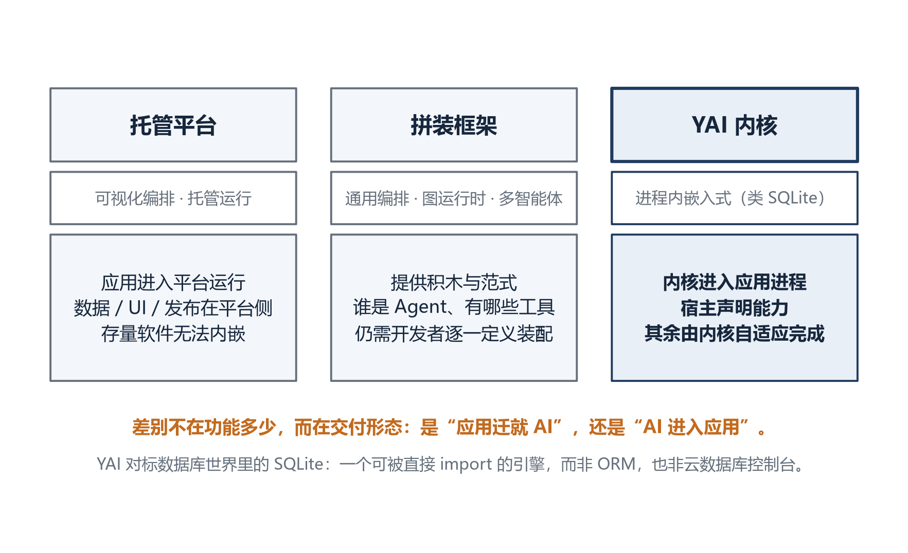
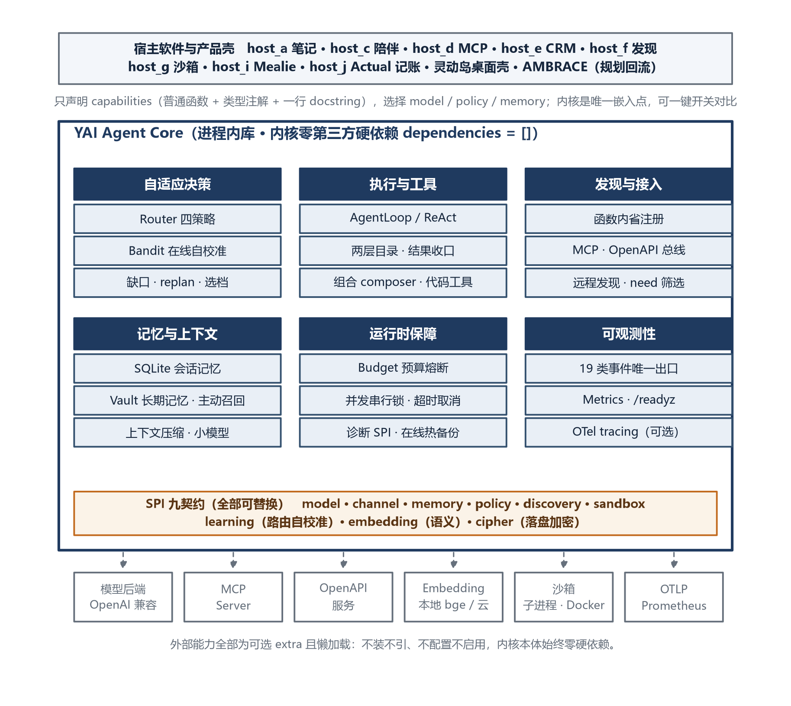
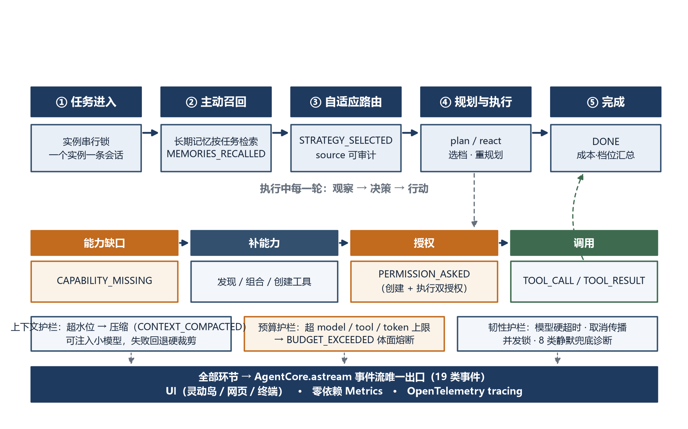
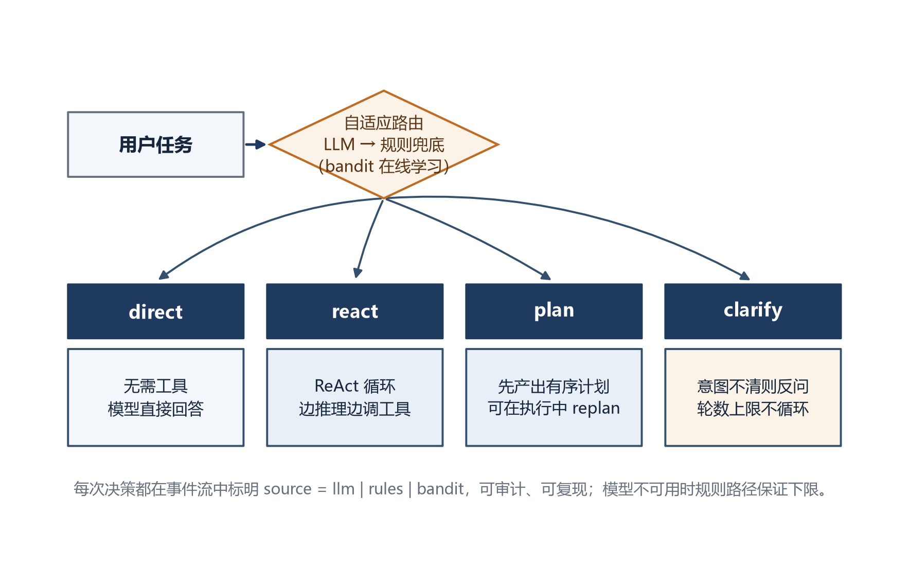
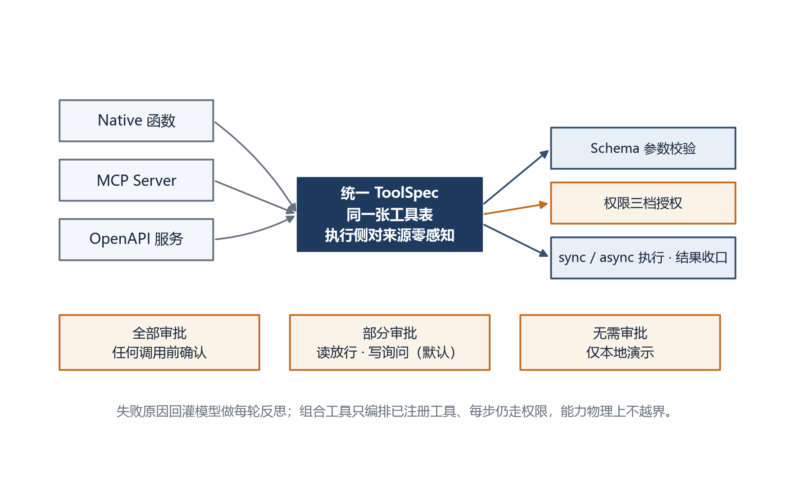
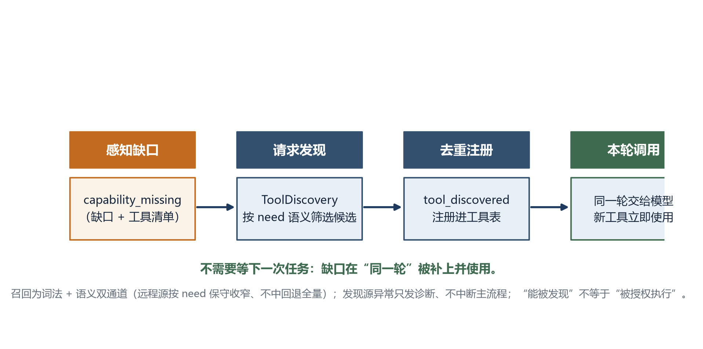
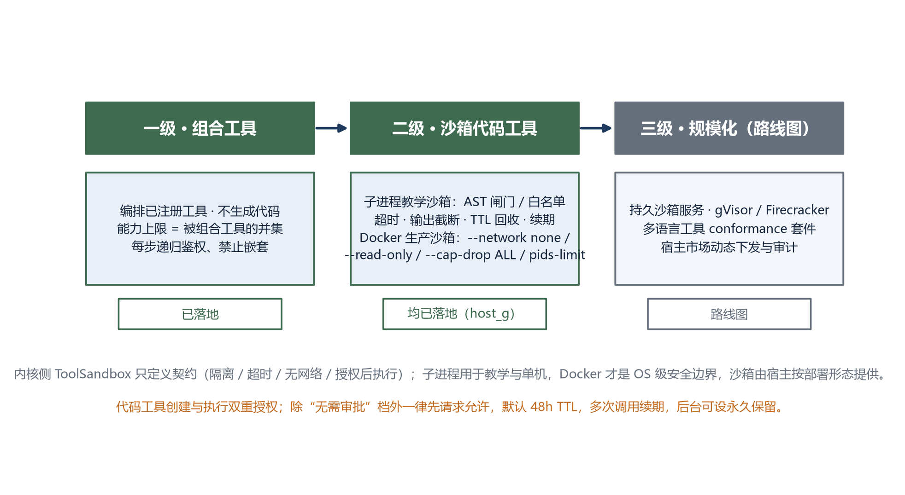
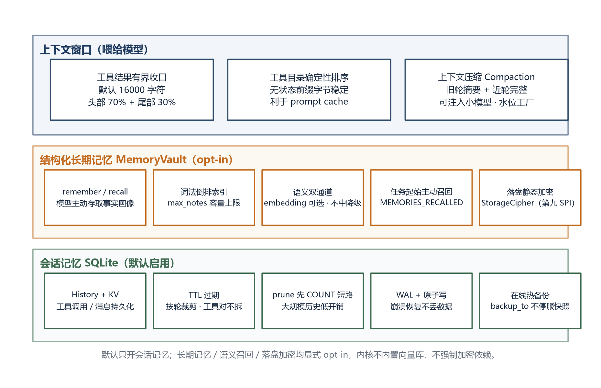
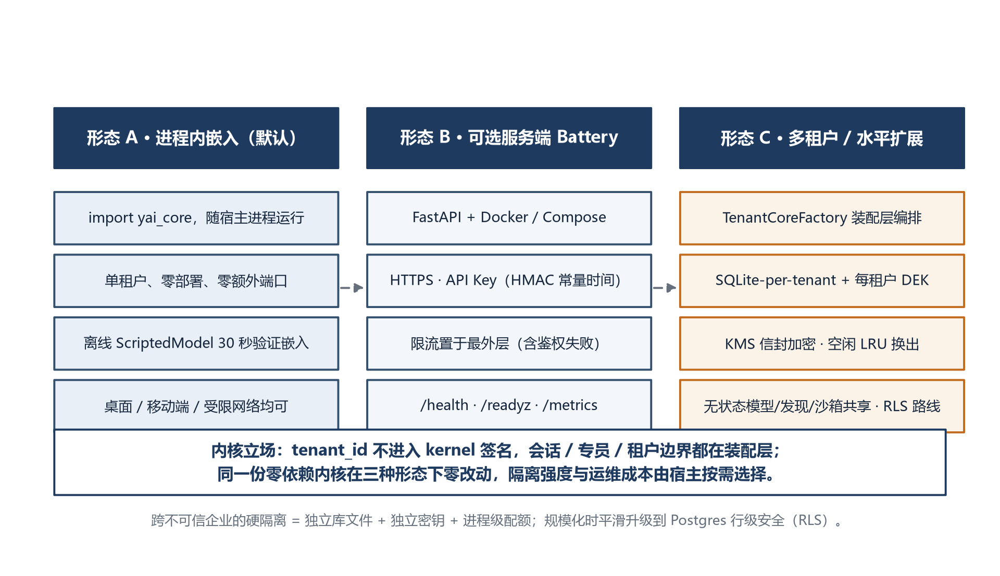

# YAI Agent Core

> 进程内嵌入式、自适应的 Agent 内核——技术白皮书

> 作者：Gi-Tuu（单人开源项目 **YAI**）
> 版本：v0.9.0　　文档日期：2026 年 10 月
> 源代码：GitHub `Gi-Tuu/yai-agent-core`　·　Gitee `Gi-Tuu/yai-agent-core`
> 软件包：PyPI `yai-agent-core`　·　许可证：MIT

| 项目 | 说明 |
|---|---|
| 一句话定位 | 被宿主软件 `import` 的进程内 Agent 内核——“Agent 世界的 SQLite” |
| 运行形态 | Python 库（≥ 3.11），随宿主进程运行；另附可选服务端 Battery 与桌面产品壳 |
| 内核依赖 | `dependencies = []`，模型 / Web / MCP / OpenAPI / 嵌入 / 加密等全部为可选 extra 且懒加载 |
| 工程规模 | 内核 83 个源文件 / 10 881 行；测试 75 个文件 / 15 117 行；834 项自动化测试，行覆盖率 96% |
| 契约与事件 | 9 个可替换 SPI 契约；19 类结构化事件，单一事件出口 |
| 示例宿主 | 8 个可运行宿主，含 2 个对真实开源软件（Mealie、Actual Budget）的端到端接入 |
| 配套产物 | 42 篇逐行讲义、中英双语文档、Docker / Compose、在线演示、桌面灵动岛产品壳 |

## 摘要

大量已有软件希望获得 Agent 能力，但主流 Agent 框架的共同前提是“开发者先有一个 Agent 要做，再去定义它的工具、流程与角色”。对于一个**已经存在**的软件——笔记应用、客户管理系统、陪伴类 App——开发者真正面对的问题是：如何在不重写业务、不引入独立服务端、不手工维护一套 Agent 循环的前提下，让软件现有的函数“自动地”被一个智能体理解、选择和调用。

本文提出并实现 **YAI Agent Core**：一个进程内嵌入式、自适应的 Agent 内核。宿主软件只需以普通 Python 函数加类型注解与文档字符串的形式声明既有能力，内核即在同一进程内完成工具的自动注册、自适应路由、能力缺口感知与按需发现、记忆管理、上下文治理、权限授权与全程可观测。内核本体零第三方硬依赖，模型、记忆、权限、发现源、沙箱、路由学习、文本嵌入与存储加密九个方向均以 SPI 契约暴露，可被宿主替换。

我们在 8 个形态各异的宿主上验证了该内核，其中包括对两个真实开源软件（食谱管理 Mealie、记账工具 Actual Budget）不经其源码改造的端到端接入；并以一个不含任何 AI 代码的销售 CRM 宿主与一个独立桌面“灵动岛”产品壳，展示了“宿主保持纯业务形态、AI 由独立工作台跨进程后装增强”的产品化效果。工程上，项目维护 834 项离线自动化测试与 96% 的行覆盖率，具备预算熔断、上下文压缩、成本选档、结构化追踪、就绪探针、离线评测等生产级运行时能力，并通过 OpenSSF Scorecard、CII Best Practices 与签名化发布流程。本文系统阐述其设计理念、总体架构、关键机制、产品形态、工程治理与诚实边界。

**关键词**：智能体内核；工具调用；能力自发现；自适应路由；进程内嵌入；模型上下文协议；权限治理；开源软件

## 1 绪论

### 1.1 背景：Agent 能力的三种交付形态

当前把大模型能力交付给软件的方式大致可分为三类，如图 1 所示。



第一类是**托管平台**，以 Dify、Coze（扣子）等为代表。它们提供可视化编排、托管运行与运营后台，开发者在平台内配置 Bot、工具与工作流。这类平台功能完整、上手快，但应用必须进入平台的运行模型，数据、界面与发布都在平台侧，一个已经独立运行的存量软件无法把这样的 Agent “内嵌”进自己的进程。

第二类是**拼装框架**，以 LangChain / LangGraph、CrewAI、AutoGen（Microsoft Agent Framework）等为代表。它们提供优秀的积木与编排范式——链、图、状态机、角色团队，但“谁是 Agent、它有哪些工具、按什么流程协作”仍需要开发者逐一定义与装配。框架回答的是“如何从零搭建一个 Agent”，而不是“如何让一个既有软件不写 Agent 代码就获得 Agent 能力”。

第三类，也是本文的位置，是**进程内嵌入式内核**。它对标数据库世界里的 SQLite，而不是 ORM 或云数据库控制台：SQLite 不要求应用启动一个独立的数据库服务，而是以库的形式进入应用进程，应用只管描述数据，引擎负责存取与事务。YAI 希望在 Agent 领域扮演同样的角色——应用只管声明自己“会做什么”，内核负责让这些能力被模型自适应地使用。

### 1.2 问题：存量软件“应用 AI 化”的工程成本

把一个普通软件改造成“带智能体的软件”，在没有内核的情况下通常需要自行实现：模型适配、对话循环、工具的 JSON Schema 生成、工具选择与执行、计划与反思、短期与长期记忆、上下文窗口管理、用户授权、能力扩展、可观测与安全兜底。这些能力与具体业务无关，却在每个应用里被重复实现，质量参差，是“应用 AI 化”最主要的一次性工程成本。市面并不缺少又一个功能堆叠的 Agent 产品，缺少的是一个**足够小、可直接嵌入、能随宿主能力自适应生长**的内核。

### 1.3 贡献清单

本文的主要贡献如下：

1. **一种进程内嵌入式的 Agent 内核形态**。内核本体零第三方硬依赖，以库的形式随宿主进程运行，通过九个 SPI 契约隔离所有外部依赖，可进入桌面、移动端与受限网络环境。
2. **能力自发现与缺口闭环**。宿主普通函数经内省自动注册，MCP 与 OpenAPI 同构接入；当现有工具不足时，内核在**同一轮**感知缺口、按需发现并注册新工具，且“发现”不等于“授权”。
3. **可自校准的自适应路由**。在内置规则与 LLM 路由之上，提供从执行反馈在线学习的上下文老虎机路由选择器，同类任务越用越准，且默认关闭、决策来源可审计、离线可复现。
4. **工具能力的三级生长路径与双授权沙箱**。从只编排已有工具的组合工具，到在沙箱中创建代码工具，再到规模化沙箱服务；创建与执行双重授权，教学沙箱与生产级 OS 沙箱边界诚实分离。
5. **面向长期运行的记忆、上下文与运行时治理**。会话记忆、结构化长期记忆、上下文压缩、成本选档、预算熔断、并发串行、超时取消、指标与追踪构成完整的生产运行时。
6. **可验证的工程与安全治理**。834 项离线测试、96% 覆盖率、模糊测试与离线评测、供应链签名与多项开源最佳实践认证，并以 8 个宿主（含两个真实开源软件）证明通用性。

## 2 设计理念

### 2.1 SQLite 式的自我定位

YAI 刻意收窄定位：它不是一个让终端用户拖拽搭建 Agent 的平台，不是一个多智能体协作框架，也不是一个无人值守的编码代理。它是一个**引擎**。判断设计取舍时遵循一条准则——这件事是否属于“任何宿主都需要、且与业务无关的 Agent 运行时机制”？是，则进入内核；否则交给宿主或可选扩展。

### 2.2 四条设计原则

- **内核最小、依赖为零**。内核本体 `dependencies = []`。模型客户端、Web 框架、MCP SDK、HTTP/YAML 解析、本地嵌入、加密、OTel 等全部进入可选 extra，并在函数内懒加载；不安装则不引入，不配置则不启用。
- **契约化、可替换**。所有外部方向都收敛为 SPI：宿主可以替换模型、记忆后端、权限策略、发现源、沙箱、路由学习算法、嵌入模型与加密实现，内核不绑定任何厂商。
- **每个自适应决策都可见**。策略选择、计划、工具调用、权限询问、能力缺口、工具发现、上下文压缩、档位切换、预算熔断等都以结构化事件发出，且事件流只有一个出口，禁止“静默决策”。
- **能力边界诚实**。内核不假装自己无所不能：工具不足时明确报告缺口，沙箱不足以对抗恶意代码时明确声明边界，评测口径不确定时不宣传绝对数字。

### 2.3 适合与不适合

YAI 适合把 Agent 能力内嵌进一个已有或新建的软件、希望保持进程内运行、不愿引入和运维独立平台、也不想自己编写 Agent 循环的团队。它不面向可视化拖拽搭建、多角色协作的多智能体系统、长周期无人值守的编码代理；这些场景有更专门的平台与框架，本文第 7 章给出诚实的选型建议。

## 3 总体架构

### 3.1 分层视图

YAI 的总体架构如图 2 所示，自上而下分为宿主层、内核层与外部可选后端三层。



**宿主层**只做两件事：以普通函数声明能力（`capabilities`），以及选择模型、权限策略与记忆后端。内核是唯一的嵌入点：宿主既可以在进程内直接 import 获得增强，也可以完全不写 AI 代码、由独立的桌面灵动岛经本地进程间通信跨进程操控，从而在不改动宿主界面的前提下直观对比有无内核的差异。本文的 8 个示例宿主覆盖笔记、陪伴、MCP、销售 CRM、能力发现、沙箱、真实食谱软件与真实记账软件等形态。

**内核层**由六组机制构成：自适应决策（路由、自校准、缺口感知、重规划、选档）、执行与工具（AgentLoop、两层工具目录、结果收口、组合与代码工具）、发现与接入（函数内省、MCP/OpenAPI 总线、远程发现）、记忆与上下文（会话记忆、长期记忆、压缩）、运行时保障（预算、并发锁、超时、诊断、热备份）以及可观测性（事件、指标、追踪、就绪探针）。横切这六组机制的是 **9 个 SPI 契约**。

**外部后端层**全部可选：OpenAI 兼容的模型服务、MCP Server、OpenAPI 服务、本地或云端嵌入模型、子进程/Docker 沙箱、OTLP/Prometheus 观测端。它们通过 extra 与 SPI 接入，缺失时内核降级而非报错。

### 3.2 九个 SPI 契约

内核以九个协议（Protocol）定义与外部世界的边界，详见附录 B：模型 `ModelProvider`、通道 `Channel`、记忆 `MemoryStore`、权限 `PermissionPolicy`、发现 `ToolDiscovery`、沙箱 `ToolSandbox`、路由学习 `RouteSelector`、文本嵌入 `EmbeddingProvider`、存储加密 `StorageCipher`。这种设计使同一份内核可以在“零外部依赖的离线脚本”与“接入完整云服务的服务端”之间平滑移动，而内核代码零改动。

### 3.3 事件流的唯一出口

内核在一次运行中产生的全部信号——策略选择、计划创建与修订、模型消息、工具调用与结果、权限询问、澄清请求、能力缺口、工具发现/组合/创建与回收、上下文压缩、记忆召回、档位切换、预算超限、错误与完成——共 19 类事件（附录 A），统一由 `AgentLoop` 产出、经 `AgentCore.astream` 这一个出口向外 emit。UI、日志、指标、追踪都作为事件的订阅方存在，从架构上杜绝了旁路输出与不可观测的决策。

### 3.4 一次运行的生命周期

一次任务在内核中的完整生命周期与运行时护栏如图 6 所示：任务进入后先获得实例级串行锁，随后按任务主动召回长期记忆，进入自适应路由；路由在 direct / react / plan / clarify 间选择，plan 策略可在执行中动态重规划，react 循环逐轮观察、决策、行动；当出现能力缺口时进入“发现/组合/创建—授权—调用”子流程；上下文超水位触发压缩，预算超限触发体面熔断，模型调用有硬超时与取消传播；最终以 `DONE` 事件输出结果并汇总成本与档位。全程事件汇入唯一出口，供 UI、指标与追踪消费。



## 4 关键机制

### 4.1 自适应路由与在线自校准

内核在每个任务开始时选择执行策略，如图 3 所示：无需工具的闲聊走 `direct`；需要边推理边调工具走 `react`；多步、有先后依赖的任务走 `plan` 并先产出有序计划；意图不清则走 `clarify` 反问，并设有轮数上限避免无限追问。



路由有三个层次，且**决策来源始终被记录在事件中**：零成本的中文/英文规则作为确定性快速路径与最终兜底；可选的 LLM 分类在规则不确定时提供语义判断，模型不可用或输出非法时自动回退规则；在两者之上，`RouteSelector` SPI 提供一个从执行反馈在线学习的**上下文老虎机**——它按任务特征分桶累计 Beta 分布的后验，以 Thompson Sampling 为同类任务选择策略，冷启动时确定性跟随规则，积累真实成败反馈后才采样，硬规则区域不表态。该机制把项目名中的“自适应（self-adaptive）”落到实处：路由不是一次性的开环分类器，而是会随使用变得更准的闭环。学习默认关闭、算法可替换，内置五线离线 benchmark（含“无先验”“无上下文”消融）可复现地显示，末段任务上学习路由成功率为 89.6%，固定规则为 73.3%；该脚本自带“学习必须显著优于规则”的硬校验，数字随 CI 产出，不人工修饰。

### 4.2 统一工具总线与权限三档

三类工具来源——宿主原生函数、外部 MCP Server、OpenAPI 服务——在注册时被归一化为同一种 `ToolSpec` 进入同一张工具表，执行侧对工具来源零感知，如图 5 所示。原生函数经类型注解与 docstring 内省自动生成 JSON Schema；MCP Client 与 OpenAPI 适配器把外部能力翻译成相同结构。工具执行前统一经过 Schema 校验、权限授权与 sync/async 执行，失败原因回灌模型供其逐轮反思。



权限由 `PermissionPolicy` SPI 决定，提供三档：**全部审批**（任何调用前确认）、**部分审批**（只读操作放行、写操作与新能力询问，默认）、**无需审批**（仅限本地演示），并支持白名单。组合工具在每一步递归鉴权，因此其能力上限物理上不超过被组合工具的并集。

### 4.3 能力缺口感知与按需发现

当模型判断现有工具不足以完成任务时，内核不是假装工具存在或盲目调用，而是发出 `capability_missing` 事件，携带缺口描述与当前可用工具清单；若宿主注入了 `ToolDiscovery` 发现源，内核即在**同一轮**请求发现、去重注册（发 `tool_discovered`）并把新工具交给模型使用，如图 4 所示。



发现匹配采用**词法 + 语义双通道**：词法通道零依赖、支持中文 bigram 与同义词，永远可用；语义通道可选地使用嵌入模型，用标准库余弦计算相似度（不把 numpy 引入内核），并以“绝对门槛 + top1 边际（margin）”策略避免在一堆相似候选中误召回，嵌入后端缺失或报错时自动降级为纯词法。对于远程发现源，内核按任务 `need` 做双向词法与语义的保守收窄（阈值 0.20、边际 0.08、top_k 为 8），不命中再回退全量目录，兼顾召回与精确。发现源异常只产生诊断事件、不中断主流程。**“能被发现”与“被授权执行”严格分离**：新发现的工具首次调用仍需经过权限闸。

### 4.4 工具能力的三级生长与双沙箱

内核把“扩展自身能力”分为三级，如图 8 所示。



- **一级·组合工具（已落地）**：模型把多个已注册工具编排为一个新工具，不生成代码，每步递归鉴权、禁止嵌套，安全性高。
- **二级·沙箱代码工具（已落地）**：模型在沙箱中创建临时 Python 工具。内核侧的 `ToolSandbox` 只定义契约（隔离、超时、无网络、授权后执行），具体实现由宿主提供：教学用的子进程沙箱内置 AST 闸门（拒绝导入节点与下划线属性访问，截断已知的内省逃逸手法）、白名单、超时与输出截断；生产用的 Docker 沙箱以 `--network none`、`--read-only`、`--cap-drop ALL`、`--no-new-privileges`、`--pids-limit` 构成真正的 OS 级边界。代码工具的**创建与执行双重授权**：除“无需审批”档外都先请求允许；临时工具默认 48 小时存活期（TTL），被多次调用则续期，使用者也可在后台将其设为永久保留。
- **三级·规模化（路线图）**：持久沙箱服务、gVisor/Firecracker 等更强隔离、跨语言工具一致性（conformance）套件与宿主市场的动态下发。

内核诚实区分两类沙箱：子进程沙箱用于教学与单机演示，不被当作对抗恶意代码的安全边界；Docker 沙箱才是生产环境的 OS 级隔离。

### 4.5 三层记忆与上下文治理

面向长期运行的数字员工，内核把“记住什么、喂给模型什么”拆成三层，如图 7 所示。



- **会话记忆（默认启用，SQLite）**：持久化消息、工具调用与键值状态，支持 TTL 过期、按对话轮裁剪（工具调用与其结果永不被拆散）、`prune` 先 COUNT 短路以在大规模历史下保持低开销；采用 WAL 与原子写保证崩溃恢复，并支持不停服的在线热备份 `backup_to`。
- **结构化长期记忆（opt-in，MemoryVault）**：模型通过 `remember` / `recall` 工具主动沉淀与检索事实画像，底层维护词法倒排索引与 `max_notes` 容量上限，可选地接入嵌入做语义双通道召回；每次任务起始可按任务自动召回相关长期记忆（发 `MEMORIES_RECALLED`）；落盘内容可经第九个 SPI `StorageCipher`（Fernet 实现）静态加密。
- **上下文窗口治理**：工具结果统一有界收口（默认 16 000 字符，保留头部 70% 与尾部 30%，并在事件中标注 `truncated` 与实际字符数）；工具目录按名称确定性排序，使无状态前缀字节稳定、利于提示缓存；当历史逼近窗口水位时进行上下文压缩（旧轮摘要 + 近轮完整），压缩可专门注入一个更小更省的模型，并提供按上下文窗口生成策略的水位工厂，压缩失败回退到硬裁剪，全程发 `CONTEXT_COMPACTED` 事件。

长期记忆、语义召回与落盘加密都需显式开启，内核不内置向量数据库、不强制加密依赖。

### 4.6 计划、重规划与成本延迟选档

`plan` 策略先生成可执行的有序计划；执行中若发现前置步骤缺失或工具结果表明需要调整，模型可通过专属的重规划元工具修订计划（发 `PLAN_REVISED`），该动作无外部副作用、不走工具授权。在内置零依赖的**选档（tiering）**机制下，内核默认使用标准档模型，仅在规划、纠偏以及进入第三轮等更需要推理能力的时刻升级到强档模型，发 `TIER_CHANGED`，并在 `DONE` 事件中汇总标准档/强档调用次数，从而在不牺牲关键决策质量的前提下控制成本。

### 4.7 预算、并发与韧性

面向“怕失控花费”与“长期挂机”的真实诉求，内核提供任务级**预算熔断**：可分别限制模型调用次数、工具调用次数与 token 用量，超限即发 `BUDGET_EXCEEDED` 并体面终止。运行时韧性方面，每个内核实例持有一把异步锁以串行化会话（一个实例同一时刻只处理一条会话），模型调用有可配置的硬超时并正确传播取消，另有八类零依赖的静默兜底诊断 SPI，把模型、发现源、沙箱等外部依赖的故障转化为可读诊断而非堆栈。配置集中于 `CoreConfig` 并支持 `from_config` 装配与启动期校验。子员工（见 5.3）默认携带硬预算，并由全局 `DelegationSupervisor` 并发闸（默认最多 5 个并行子任务、跨层级共享）约束总量。

### 4.8 可观测性与离线评测

内核在不依赖任何监控厂商的前提下内置零依赖的 `MetricsRecorder`，并暴露 `/readyz` 与 `/metrics`（支持 JSON）探针；订阅事件流即可获得 OpenTelemetry 指标桥接（`[otel]` extra）。结构化追踪以一个 root span `yai.agent.run` 包裹一次运行，在外侧订阅 `astream` 实现，不侵入内核。此外提供离线评测包：以黄金任务（GoldenTask）采集执行轨迹、逐任务打分并聚合，作为 CI 中的非门禁评测作业；其口径保持诚实——评测衡量的是路由策略与链路正确性，不宣传无法保证的“幻觉率”之类绝对指标。

### 4.9 安全设计

安全机制贯穿工具链：API Key 以 `hmac.compare_digest` 做常量时间比较，未配置时鉴权默认关闭并在文档中显著提示；限流中间件置于最外层，使鉴权失败的请求同样计入频率，避免在线爆破；响应体有大小守卫；所有 SQLite 访问参数化；SSRF 面通过宿主配置 base_url、路径编码、不跟随重定向等手段收敛；代码工具的创建与执行双重授权，高危能力默认询问。第 8 章进一步说明哪些机制是安全边界、哪些不是。

## 5 产品形态与场景验证

### 5.1 一个内核，多种宿主

内核在 8 个可运行宿主上验证，覆盖从教学示例到真实开源软件的谱系：

| 宿主 | 类型 | 主要验证点 |
|---|---|---|
| host_a 笔记 | 原生函数 | 函数内省自动注册、记忆工具 |
| host_c 陪伴 | 原生函数 | 陪伴场景的情绪与记忆能力（AMBRACE 概念原型） |
| host_d MCP | MCP Client | 接入外部 MCP Server 的同构工具总线 |
| host_e 销售 CRM | 纯宿主垂直产品 | 纯标准库 HTTP 工具服务、零 AI 界面，由灵动岛跨进程操控；客户/商机/订单 |
| host_f 发现 | ToolDiscovery | 远程发现源按 need 的语义筛选与当轮注册 |
| host_g 沙箱 | 双沙箱 | 子进程教学沙箱与 Docker 生产沙箱、代码工具 TTL |
| host_i Mealie | 真实开源软件 | 对食谱管理软件 Mealie 的 OpenAPI 端到端接入 |
| host_j Actual | 真实开源软件 | 对记账软件 Actual Budget 的第三方播种与子员工委派 |

### 5.2 纯宿主门面：零 AI 代码的销售 CRM，被灵动岛跨进程操控

host_e 是一个功能自洽的销售 CRM：客户、订单、商机、跟进记录、待办与日报，具备统计卡片、搜索筛选与数据持久化，且**整个网页不包含任何 AI 代码或 AI 界面**——没有聊天框、没有开关，它本身就是一个完整、独立可用的业务系统，如图 10。Agent 能力完全由独立的桌面灵动岛提供：在灵动岛选择“销售专员”后，内核通过本地 HTTP（127.0.0.1:8200）调用 CRM 经纯标准库 `ToolService` 暴露的 24 个业务工具，用户说一句话即可新增客户、录入订单、查询档案，CRM 页面以定时轮询自动刷新出新数据，如图 11。当任务需要 CRM 原本不具备的能力时（如查询拜访地天气、按税率计算含税价），内核感知能力缺口、从宿主按需目录发现 `get_visit_weather`、`calc_quote_with_tax` 并请求授权。这一形态比“应用内开关”更彻底地证明了内核立场：**宿主可以零 AI 代码，Agent 是一个可后装、可独立运行的跨进程智能内核**。


### 5.3 桌面产品壳：灵动岛与子员工

为说明内核不必依赖宿主自建交互窗口，项目附带一个桌面“灵动岛”产品壳（PySide6）：平时是一枚可拖拽、全局热键（Ctrl+Alt+Y）呼出的悬浮球（图 12），展开后是一个轻量工作台（形态见图 11）。工作台顶部集中了 Core 开关、审批档位、工具管理、学习状态与自动收回等设置；左侧以可折叠的一行容纳销售、仓库、笔记、陪伴等多个宿主“专员”，用户在同一面板内切换专员、处理不同软件的事务。其中“销售专员”不依赖任何进程内装配，而是通过本地 HTTP 跨进程连接一个零 AI 代码的销售 CRM（host_e，§5.2），在浮窗里完成建客户、录订单、查档案等操作，CRM 网页本身保持不变。这体现了“内核独立、灵动岛集成多个宿主”的关系：多个应用各自运行，灵动岛作为统一对话前台按需连接，而不是某个应用的附属聊天框。


在灵动岛与 host_j 之上，内核支持**子员工委派**：一个宿主专员可以把只读子任务并行委派给子员工，子员工默认携带硬预算并受全局并发闸约束。host_j 以一条“五拍标准线”同时覆盖能力发现链路与子员工委派链路，并以 17 例离线测试固定行为。

### 5.4 对真实开源软件的第三方播种

最能说明通用性的，是对两个与本项目无关的真实开源软件的接入。host_i 面向食谱管理软件 Mealie，通过其 OpenAPI 描述自动注册工具，在 Docker 实跑环境中完成真实查询；host_j 面向记账软件 Actual Budget，通过其官方命令行能力（以可注入 runner 的子进程方式，内核与示例均不引入 Node 依赖）完成记账任务，并以完整的离线 Fake 回放保证 CI 不依赖网络。两者都**未修改对方源码**，仅以声明/适配方式“播种”内核，验证了内核对存量软件的适配成本。

### 5.5 部署形态与多租户

同一零依赖内核支持三种部署形态，如图 9：默认的进程内嵌入（零部署、零额外端口）、可选的 FastAPI 服务端 Battery（Docker/Compose、HTTPS、API Key、限流、响应守卫与健康/就绪/指标探针），以及面向 SaaS 的多租户/水平扩展形态。在内核立场中，`tenant_id` 不进入内核函数签名，会话、专员与租户边界都属于**装配层**责任：参考实现给出 SQLite-per-tenant、每租户数据加密密钥（DEK）经 KMS 信封加密、空闲实例 LRU 换出、无状态模型/发现/沙箱共享的方案，并给出规模化时升级到 Postgres 行级安全（RLS）的路线。同一份内核在三种形态下零改动。



## 6 工程质量与开源治理

### 6.1 测试与质量门

项目维护 834 项自动化测试（829 通过、5 项因无 Docker 守护进程/无本地模型权重等环境条件跳过），全部离线运行，不依赖网络或 API Key；对内核的行覆盖率为 96%（4 602 条语句、184 条未覆盖），CI 设有 90% 的覆盖率下限。测试普遍使用假模型（ScriptedModel）、Mock 传输与可注入时钟，使得自适应路由、发现闭环、预算熔断等行为都能确定性复现。持续集成在 Ubuntu 的 Python 3.11/3.12/3.13 与 Windows 的 Python 3.13 上运行 Ruff、mypy 与 pytest；另有模糊测试（atheris，非门禁）、路由 benchmark 曲线作业与离线评测作业。

### 6.2 供应链安全与最佳实践

发布流水线对构建产物生成 SLSA 来源证明（provenance）并用 cosign 做 keyless 签名，PyPI 采用基于 OIDC 的可信发布；GitHub Actions 全部钉死提交 SHA、仅授予最小权限，并启用 Dependabot 与 CodeQL。项目通过 OpenSSF Best Practices（CII）Passing 级认证，并在 OpenSSF Scorecard 中取得良好成绩，其中令牌权限与依赖钉版两项为满分。安全报告流程以 `SECURITY.md` 明确。

### 6.3 文档与可学习性

考虑到项目同时是作者边学边建的载体，仓库提供 42 篇逐行讲义（walkthrough），从最小内核一直讲到上下文压缩、记忆规模治理、并发诊断、结构化追踪与第三方播种，配合中英双语的 README、架构、对比、部署与安全文档，以及 CONTRIBUTING、Issue/PR 模板。内核保持零硬依赖与小体量，本身即可作为学习 Agent 运行时的可读样本。

## 7 与同类方案的诚实对比

表 1 依据各方案官方文档的自我定位与本仓库可验证事实给出对比，不做贬低式比较。

**表 1　关键维度对比**

| 维度 | YAI Agent Core | LangChain/LangGraph | CrewAI/AutoGen | Dify | Coze |
|---|---|---|---|---|---|
| 交付形态 | 被 import 的库，随宿主进程 | 库/框架 | 库/框架 | 自托管服务端平台 | 托管 SaaS |
| 嵌入存量软件 | 进程内 import，唯一嵌入点、可开关 | 需自行装配循环 | 多智能体范式需应用配合 | 应用成为平台客户端 | 无法嵌入 |
| 内核运行时依赖 | 无（dependencies=[]） | 分层依赖包 | 框架依赖 | 完整服务端栈 | 无（平台托管） |
| 工具接入 | 内省 + MCP + OpenAPI + 按需发现闭环 | 工具抽象与集成包 | 工具抽象 | 平台内工具/市场 | 平台插件生态 |
| 工具发现匹配 | 词法 + 语义双通道、门槛与边际防误召回 | 多为手工绑定或全量入 prompt | 无内置 | 固定工具集按名选择 | 平台市场 |
| 路由自校准 | 上下文老虎机在线学习（默认关、可复现） | 需自建 | 无 | 无 | 无 |
| 多智能体 | 明确不做（属宿主层） | 可自建 | 原生强项 | 支持 | 原生 |
| 决策可观测 | 19 类事件唯一出口 | 依赖外部服务 | 框架日志/外部 | 平台日志 | 平台内置 |
| 离线可测 | 全量测试离线、无需 Key | 需自行 mock | 需自行 mock | 依赖平台 | 依赖平台 |

YAI 的差异化主张可概括为：范式上从“拼装框架”反转为“嵌入式内核”；能力上自发现而非手工注册；路由上具备能力缺口闭环与在线自校准；工程上零硬依赖加九契约可替换。相应地，需要可视化拖拽搭建选 Dify/Coze，需要多角色协作选 CrewAI/AutoGen，需要精细图编排选 LangGraph，需要最丰富集成生态做快速原型选 LangChain；而要把 Agent 能力内嵌进已有软件、保持进程内运行且不自己写 Agent 循环，正是 YAI 的位置。需要说明的是，YAI 是单人新项目，成熟度与生态规模不能与上述成熟产品等量齐观，这一边界在第 8 章明确陈述。

## 8 诚实边界

- **成熟度与生态**：项目为单人维护的新项目，测试覆盖与工程治理较完善，但第三方采用度、插件生态与长期迭代历史仍处早期。
- **明确不做**：内核不提供 MCP Server、多智能体编排、内置 UI（灵动岛是独立产品壳而非内核）、无人值守编码代理、内置向量数据库，也不内置生产沙箱执行器（仅定义契约）。
- **沙箱边界**：子进程教学沙箱含 AST 闸门与白名单，但不被视为对抗恶意或被操纵模型的安全边界；生产隔离应使用 Docker 等 OS 级沙箱。
- **评测口径**：89.6% 对 73.3% 的数字仅衡量路由策略在固定 benchmark 上的表现，不代表端到端任务成功率，更不代表幻觉率；语义召回阈值随本地 bge-m3 校准，换模型可能变化。
- **可选能力**：长期记忆、语义召回、落盘加密、OTel、服务端鉴权均为显式 opt-in；服务端在未设置密钥时鉴权默认关闭，公网部署必须自行配置。
- **多租户**：内核不内置租户隔离，跨不可信租户的硬隔离（独立库文件、独立密钥、进程配额乃至 Postgres RLS）由装配层承担。
- **在线演示**：免费托管层存在冷启动延迟，演示数据为虚构。

## 9 未来工作

近期工作包括：发布持久沙箱服务参考实现与 gVisor/Firecracker 适配、跨语言工具一致性套件、ToolDiscovery 生态市场索引，以及多租户的 Postgres RLS 参考实现与移动端壳。里程碑意义上的 v1.0 目标，是把成熟后的内核重新内嵌入作者的 AI 陪伴开源项目 AMBRACE，使其在保持陪伴定位的同时获得工具调用、记忆、规划、主动行为与有限自主操作能力；在双方（内核与宿主）都准备好之前，版本将停留在 0.9.x，不提前发布 1.0。

## 10 结语

YAI Agent Core 试图证明一件具体的事：Agent 能力可以像数据库引擎一样，以一个足够小、零硬依赖、契约清晰的库进入任意软件，随宿主声明的能力自适应地生长——发现缺口、补齐能力、记住经验、控制成本、暴露决策，并在需要时安全地创造新工具。本文给出的不是一个功能清单，而是一套可嵌入、可替换、可验证、可长期运行的内核机制，以及它在真实软件上的落地证据。

## 附录 A　19 类结构化事件

`STRATEGY_SELECTED`（策略选择）、`PLAN_CREATED`（计划创建）、`MODEL_MESSAGE`（模型消息）、`TOOL_CALL`（工具调用）、`TOOL_RESULT`（工具结果）、`PERMISSION_ASKED`（权限询问）、`CLARIFY_REQUESTED`（澄清请求）、`CAPABILITY_MISSING`（能力缺口）、`TOOL_DISCOVERED`（工具发现）、`TOOL_COMPOSED`（工具组合）、`CODE_TOOL_CREATED`（代码工具创建）、`CODE_TOOL_RETIRED`（代码工具回收）、`CONTEXT_COMPACTED`（上下文压缩）、`MEMORIES_RECALLED`（记忆召回）、`PLAN_REVISED`（计划修订）、`TIER_CHANGED`（档位切换）、`BUDGET_EXCEEDED`（预算超限）、`ERROR`（错误）、`DONE`（完成）。

## 附录 B　九个 SPI 契约

| 契约 | 职责 |
|---|---|
| ModelProvider | 模型对话，支持标准/强档位与可注入的压缩模型 |
| Channel | 用户交互通道与离线批准 |
| MemoryStore | 会话历史与键值记忆 |
| PermissionPolicy | 工具调用授权（三档 + 白名单） |
| ToolDiscovery | 按能力需求发现候选工具 |
| ToolSandbox | 代码工具的隔离执行（隔离/超时/无网络/授权后执行） |
| RouteSelector | 路由策略的在线学习与选择 |
| EmbeddingProvider | 语义召回所需文本嵌入 |
| StorageCipher | 记忆落盘的静态加密 |

## 附录 C　复现方式

```bash
# 获取源码
git clone https://github.com/Gi-Tuu/yai-agent-core.git
cd yai-agent-core
# 安装（内核本体零依赖；按需启用 extra，如 llm/server/mcp/openapi）
pip install yai-agent-core            # 或 pip install -e ".[llm,server]"
# 全量离线测试与覆盖率
pytest --cov=yai_core --cov-report=term
# 运行示例宿主（以销售 CRM 为例，见 examples/host_e_sales_crm）
# 重绘本文架构图
python docs/competitions/shanghai/draw_figs.py
```

## 参考文献

[1] Anthropic, *Introducing the Model Context Protocol*, https://modelcontextprotocol.io.
[2] OpenAPI Initiative, *OpenAPI Specification*, https://www.openapis.org.
[3] OpenTelemetry Authors, *OpenTelemetry Specification*, https://opentelemetry.io.
[4] Russo D. J., Van Roy B., Kazerouni A., Osband I., Wen Z. *A Tutorial on Thompson Sampling*. Foundations and Trends in Machine Learning, 2018.
[5] Yao S. et al. *ReAct: Synergizing Reasoning and Acting in Language Models*. ICLR, 2023.
[6] SQLite Consortium, *Appropriate Uses For SQLite*, https://www.sqlite.org/whentouse.html.
[7] OpenSSF, *Scorecard* 与 *CII Best Practices Badge*, https://securityscorecards.dev , https://www.bestpractices.dev.
[8] Mealie, https://mealie.io；Actual Budget, https://actualbudget.org.
