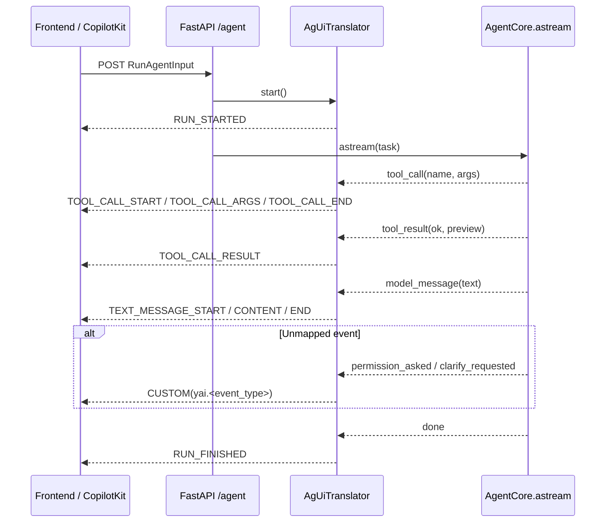
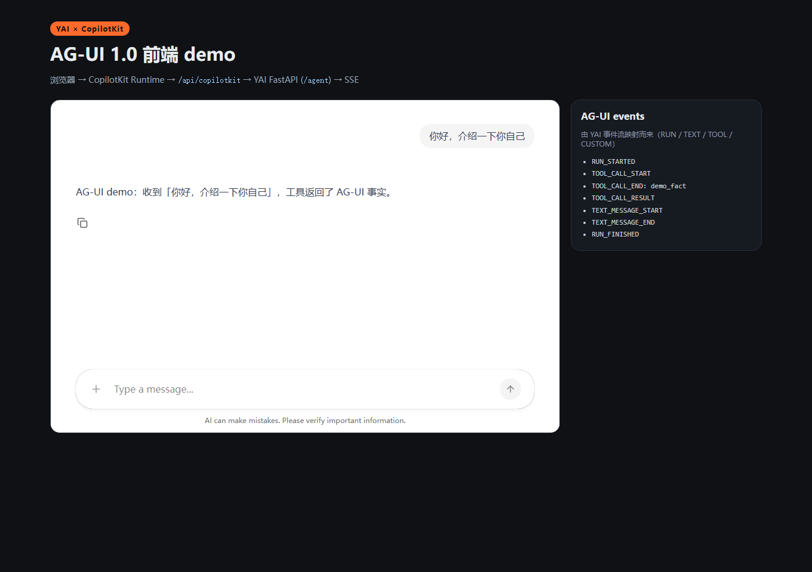

> English translation of [中文](ag-ui.md) · The Chinese version is canonical; if they disagree, the Chinese wins.

# AG-UI Adapter (Agent ↔ Frontend)

**English** · [简体中文](ag-ui.md)

YAI has exactly one event exit (`AgentCore.astream`). This adapter translates that stream into
[AG-UI 1.0](https://docs.ag-ui.com/spec/1.0) SSE events so standard frontends (React / CopilotKit)
can talk to a YAI agent without a private protocol or QML shell.

It is an **outside subscriber**, not part of the kernel:

- it does not modify `kernel/` / `core.py` and does not add a second event stream;
- it depends on the standard library only (events are dicts, SSE is string framing);
- it ships no UI: it emits standard events; rendering is the frontend's job.

## 1. Mapping

| YAI event | AG-UI events | Fields |
|---|---|---|
| run start | `RUN_STARTED` | `threadId` / `runId` |
| `model_message` | `TEXT_MESSAGE_START` / `TEXT_MESSAGE_CONTENT` / `TEXT_MESSAGE_END` | `messageId`, `delta`, `role="assistant"` |
| `tool_call` | `TOOL_CALL_START` / `TOOL_CALL_ARGS` / `TOOL_CALL_END` | `toolCallId`, `toolCallName`, `delta`=JSON args |
| `tool_result` | `TOOL_CALL_RESULT` | `messageId`, `toolCallId`, `content`, `role="tool"`, `metadata.ok` |
| `done` | `RUN_FINISHED` | `threadId` / `runId` / optional `result` (final text) |
| `error` | `RUN_ERROR` | `message`, `code`=stage |
| anything else (strategy/plan/approval/clarify…) | `CUSTOM` | `name="yai.<event_type>"`, `value`=raw payload |

Rule: map what maps cleanly; **everything else is preserved as `CUSTOM`** — no information loss and no
pretending of semantics. `permission_asked` / `clarify_requested` are `CUSTOM` today (AG-UI's
interrupt/resume lifecycle is not wired yet).

### 1.1 Sequence diagram



`CUSTOM` is the fallback branch: strategies, plans, approvals and clarifications without an AG-UI
equivalent are preserved here, not dropped.

## 2. SSE framing

AG-UI 1.0 HTTP+SSE: the client `POST`s one `RunAgentInput` JSON; the response is
`text/event-stream` where each `data:` carries exactly one complete event (LF line endings):

```
data: {"type":"RUN_STARTED","threadId":"thr-1","runId":"run-1"}

data: {"type":"TEXT_MESSAGE_START","messageId":"msg-1","role":"assistant"}

data: {"type":"TEXT_MESSAGE_CONTENT","messageId":"msg-1","delta":"hello"}

data: {"type":"TEXT_MESSAGE_END","messageId":"msg-1"}

data: {"type":"RUN_FINISHED","threadId":"thr-1","runId":"run-1"}
```

`AgUiTranslator` owns the state machine (message ids, tool-call correlation, termination),
`encode_sse()` frames one event, and `stream_sse()` feeds a FastAPI `StreamingResponse` directly.

## 3. Run the example

```bash
uv sync --extra server
uv run uvicorn examples.host_ag_ui_sse.app:app --port 8000
```

```bash
curl -N -X POST http://127.0.0.1:8000/agent \
  -H 'Content-Type: application/json' \
  -H 'Accept: text/event-stream' \
  -d '{"threadId":"thr-1","runId":"run-1","messages":[{"id":"m1","role":"user","content":"hello"}]}'
```

The example uses `ScriptedModel` (offline, no key); swap in `OpenAICompatProvider` for a real model.
On the frontend, point `@ag-ui/client`'s `HttpAgent` at `http://127.0.0.1:8000/agent`.

## 4. Code entry point

```python
from yai_core.integrations.ag_ui import AgUiTranslator, encode_sse

translator = AgUiTranslator(thread_id="thr-1", run_id="run-1")
for event in translator.start():
    yield encode_sse(event)
async for agent_event in core.astream("hello"):
    for event in translator.translate(agent_event):
        yield encode_sse(event)
for event in translator.finish():
    yield encode_sse(event)
```

## 5. Honest boundaries

- **Not token-level streaming**: YAI's `model_message` is complete text, so the adapter sends one
  `CONTENT` event; true token streaming needs incremental model events in the kernel (not in scope).
- **Tool results are bounded previews**: `preview` is the kernel's already-truncated result, not the
  full output.
- **Approval / clarify do not use AG-UI interrupts yet**: they are `CUSTOM`; wiring interrupt/resume
  needs a frontend ↔ adapter resume contract (future work).
- **No `STATE_SNAPSHOT` / `MESSAGES_SNAPSHOT`**: YAI's conversation history belongs to the host; the
  adapter does not duplicate it.
- Verified: event mapping, SSE framing and the example host; **not** end-to-end against a real
  CopilotKit frontend.


## 7. Real CopilotKit frontend demo (v0.41)

The example lives in [`examples/host_ag_ui_copilotkit/`](https://github.com/Gi-Tuu/yai-agent-core/tree/main/examples/host_ag_ui_copilotkit):
**real CopilotKit v2** (`CopilotKitProvider` + `CopilotChat`) consuming YAI's AG-UI SSE.

```
browser CopilotChat
  → CopilotKit Runtime /api/copilotkit
  → HttpAgent
  → YAI FastAPI /agent (SSE emitted by this adapter)
```



```bash
# Terminal A: YAI AG-UI SSE host (offline ScriptedModel)
uv run uvicorn examples.host_ag_ui_sse.app:app --host 127.0.0.1 --port 8000

# Terminal B: CopilotKit runtime + frontend
cd examples/host_ag_ui_copilotkit
npm install && npm run build && npm start   # http://127.0.0.1:4000
```

Verified locally (2026-11-14): `/api/copilotkit/info` returns `mode: sse`; the example really calls
a local `demo_fact` tool once, CopilotChat renders the reply, and the event panel shows
`RUN_STARTED / TOOL_CALL_* / TEXT_MESSAGE_* / RUN_FINISHED`. CI guards the build via
`.github/workflows/copilotkit-demo.yml` (`npm ci` + `npm run build`).
Boundaries: single-user local demo (pinned `identifyUser`), offline `ScriptedModel`, no Copilot
Cloud or production auth; the frontend uses CopilotKit `@copilotkit/runtime@1.87.1` v2 APIs.

## 6. Tests

```bash
uv run pytest tests/test_ag_ui_adapter.py -q
```

Covers lifecycle, text messages, tool-call correlation, failed tool results, `CUSTOM` mapping,
terminal idempotency, SSE single-frame format, and the FastAPI example host (offline TestClient).
