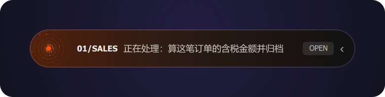
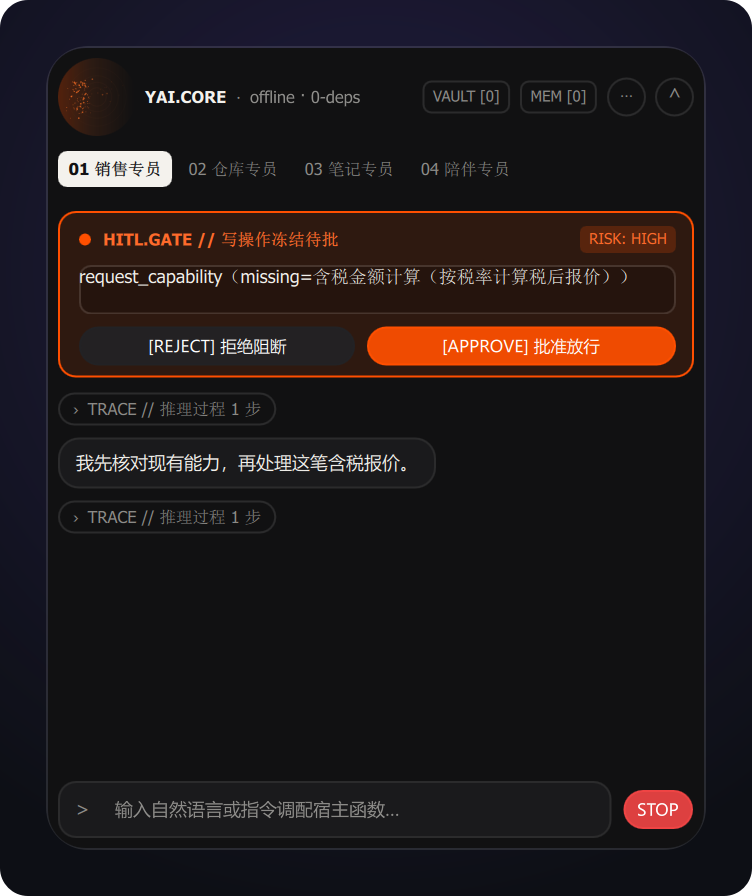
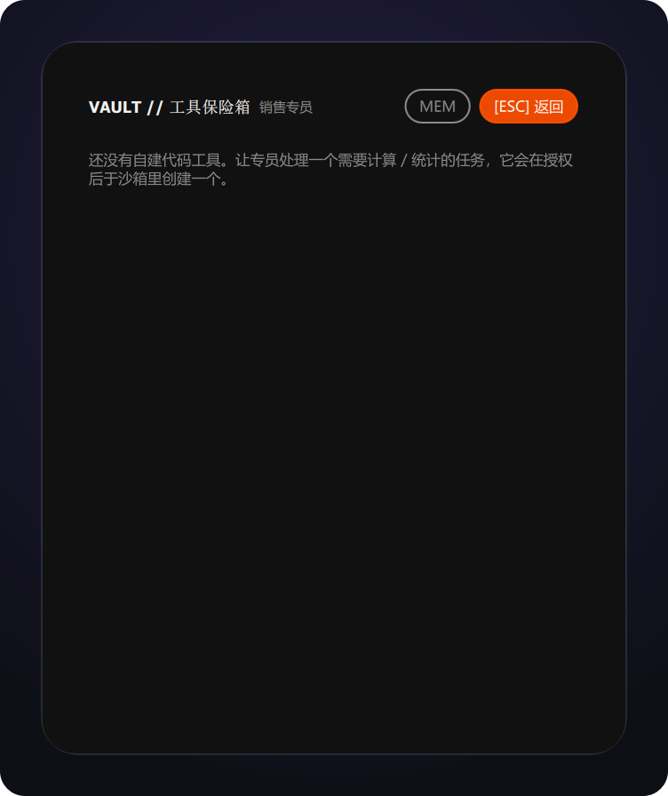
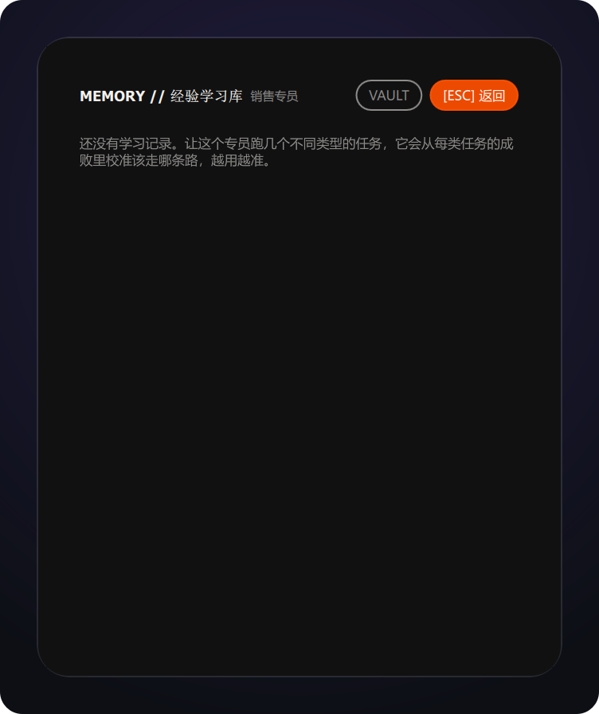

# 逐行讲解 22 · 原生桌面端：把员工做成一颗会形变的胶囊（`shell/desktop/`）

> 第 14 篇的薄壳浮窗原本是 **HTML + 本地 HTTP + SSE**：窗口是浏览器控件，像素是网页，
> 双击启动还要抢一个本地端口。本篇把它换成 **PySide6 + QML 原生渲染**：
> 真窗口形变动画、真系统托盘，而且**内核与界面在同一个进程里**——
> 这才是本项目"进程内嵌入式内核"主张该有的样子。
> 边界先说死：依赖只进 `[desktop]` 可选 extra 与顶层 `shell/`，
> `src/yai_core` 依旧零第三方硬依赖、不感知界面存在。

## 0. 先看效果

```powershell
uv sync --extra desktop          # 或 uv pip install -e ".[desktop]"
.\.venv\Scripts\python.exe -m shell.desktop          # 离线演示：无 API Key 看全部动效
.\.venv\Scripts\python.exe -m shell.desktop --live   # 接真实模型
```

屏幕顶部居中出现一条 440×52 的黑色胶囊；交代任务后它自己展开成 440×536 的员工面板，
路由决策、能力缺口、新工具飞入、授权卡、子员工出芽，全部由真实内核事件驱动。

## 1. 为什么不是 pywebview / Tauri / Electron

判据只有一条：**内核还能不能留在宿主进程里**。

| 方案 | 渲染 | 内核位置 | 结论 |
|---|---|---|---|
| pywebview（上一版） | WebView2 网页 | 同进程，但要开 HTTP 服务喂前端 | 伪原生：端口、SSE、窗口 resize 硬切 |
| Tauri / Electron | 仍是网页像素 | 必须拉 Python sidecar | 主张退化成"客户端 + 服务" |
| **PySide6 + QML** | Qt 场景图，真原生 | **同进程，`import yai_core` 即可** | 采用 |

## 2. 目录与职责

```
shell/desktop/
├── runtime.py     # ShellRuntime(QObject)：后台 asyncio 线程 + 任务生命周期 + 挂起决策
├── channel.py     # QtChannel：Channel SPI 的 Qt 实现（ask/confirm 挂起等界面点按钮）
├── host.py        # 装配：离线演示事件源 / 真实模型 AgentCore.auto + delegate
├── app.py         # QApplication + QQmlApplicationEngine + 托盘 + 屏幕定位
└── qml/
    ├── YaiTheme/  # Theme 单例（配色/尺寸/时长唯一来源，换主题只改这里）
    ├── main.qml   # 窗口：胶囊态 ⇄ 面板态的真窗口形变 + 事件→动效映射
    └── Panel.qml  # 面板：授权卡 / 过程时间线 / 权限三档 / 输入
```

### 2.1 视觉层：光学黑曜石与四态星云

桌面壳的视觉 token 全部集中在 `qml/YaiTheme/Theme.qml`，本轮换成
**Optical Obsidian + Braun Signal Orange**，但保留原运行时 token
（`fontMono / topMargin / dragSlop / msFast / msNormal / msSlow / idleDot /
warnTint / badTint / knob`），避免其他 QML 文件因缺 token 编译失败。

- 尺寸保持正交：球 `52×52` → 胶囊 `440×52`（只向右长）→ 面板 `440×536`
  （只向下长）；
- 壳层必须**不透明**：半透明会让桌面其他窗口的文字透进对话；
- `NebulaOrbCanvas.qml` 是球/胶囊/面板顶栏共用的四态动效：
  `idle` 向右漂散、`working` 顺时针行星、`complete` 冲击波、`frozen` 减速静止；
- 星云的渲染特征与设计稿同源：四色调色板（左深橙 → 琥珀 → 右侧象牙白）、
  核心径向光晕、虚线旋转轨道、顺时针拖尾弧、行星球渐变与暗环、呼吸透明度、
  纵向波动、超新星粒子爆发与双冲击波；所有运动按真实 dt 积分，
  **降帧只损失流畅度、不损失速度**（旧版按帧推进，20fps 时漂移只有 60fps 的三分之一速度）；
- 常驻桌面要控成本，但星云是桌面的主视觉，**四态统一 60fps**（空闲/工作/完成都 60），
  冻结减速到 0 后停画。空闲也保持 60fps 是因为星云一直在向右漂散，
  降帧会让"左深右浅"的漂移出现顿挫。
- **渲染后端是软件光栅，星云不占 GPU**：Windows 置顶透明岛必须走
  `QT_QUICK_BACKEND=software`（`UpdateLayeredWindow`，逐像素 alpha 跨进程合成正确）；
  实测本机 60fps 时该进程 GPU Engine 占用为 **0%**（GPU 计数器按 pid 过滤后无任何样本）。
  QML `Canvas` 本身就是 QPainter CPU 光栅，即使打开 RHI 也不会把星云搬到 GPU；
  真要 GPU 化得换成 `ShaderEffect`，而本机置顶窗在 RHI 下会破：
  d3d11 整窗白、d3d12 圆角黑块、opengl 岛不可见。**GPU 路线在当前窗口形态下被堵死**，
  只能靠 CPU 侧省帧。
- 实测（真实进程内采样，非 Timer 间隔；2026-10-25，2560×1600 / dpr 1.5）：
  - 胶囊 `440×52`：CPU **17.6% 单核**，星云真实重绘 **62.5 次/秒**，
    重绘间隔 p50 **16.03ms** / p95 **16.92ms** / max 23.6ms，**没有一次超过 2× 名义间隔**
    （即无掉帧）；窗口呈现 124.9 帧/秒（软件场景图每次画布重绘呈现 2 帧）。
  - 球 `52×52`（常驻形态）：CPU **10.2% 单核**，重绘 62.3 次/秒，
    间隔 p50 16.01ms / p95 16.99ms，1201 个间隔里只有 1 次超 2×。
  - 省帧手段：预置配色串 + `globalAlpha`（免每帧拼/解析 260 次 rgba）、
    未吸积时跳过每粒两次三角函数。优化前后配对中位数：
    胶囊 30fps 11.17% → 7.74%（**-30.7%**）、胶囊 60fps 20.64% → 19.12%（-7.4%）、
    球 30fps 6.18% → 4.73%（**-23.5%**）、球 60fps 9.60% → 8.16%（-15.0%）。
  - **粒子数 120 → 260 实测无 CPU 差异，帧率才是成本杠杆**，故粒子数取设计稿同源的 260。
  - 渲染杠杆实测：`Canvas.Immediate` 无收益反而略差，`Canvas.Image`（降分辨率）
    只在球态更省、胶囊态无差异，代价是画面变软 —— 两者都不采用，保持
    `FramebufferObject + Cooperative`。
  - 透明边缘验收：洋红底板上岛的四角像素全为洋红（= 逐像素 alpha 正确，
    圆角外透出底板），判定 `transparent_ok`。
- `main.qml` 只在 `done` 时短暂切 `complete`；`Panel.qml` 顶栏使用同一份
  `orbPhase`，三态视觉一致。
- 星云计时器同时检查组件的有效 `visible` 与所属 `Window` 的可见性/最小化状态：
  **隐藏父容器、隐藏窗口或最小化都停止周期性 `requestPaint`，重新显示后恢复原帧率**。
  `Item.visible` 本身不会随窗口隐藏变假，单独检查它会留下后台空转计时器；
  冻结至零的星云重新显示仍保持静止，离开冻结态才恢复。本边界不等于整个应用零 CPU，
  也不检测被其他窗口遮挡的情况。`tests/test_desktop_render_backend.py` 用独立 Qt 进程
  验证计时器真实触发次数、父容器隐藏、窗口隐藏/最小化、恢复与冻结状态，不只匹配源码字符串。









- 外壳结构同步设计稿：胶囊是 `01/SALES + 状态 + OPEN + 收起`；面板顶栏是
  `YAI.CORE · 模型 + VAULT/MEM`，下面是编号专员标签、`HITL.GATE` 审批卡、
  `TRACE // 推理过程`、提示 chips 与 `> ... RUN` 输入条；VAULT/MEM 是全屏
  面板，顶部可直接互切并 `[ESC] 返回`。

压缩包里的 `web_preview/` 依赖 Tailwind CDN + Google Fonts，且是独立 mock，
本轮**没有**并入仓库；网页宿主仍使用零依赖 `http.server` + SSE。

## 3. 线程纪律：一条信号跨两个世界

内核跑在专用 asyncio 线程（`ShellRuntime._run_loop`），Qt 场景图只认 GUI 线程。
两边之间**只有 Qt 信号**这一条通道，且方向明确：

- **下行（内核 → 界面）**：`_guarded()` 逐条取事件，`eventReceived.emit(类型, JSON)`。
  跨线程 emit 由 Qt 自动按 `QueuedConnection` 投递到 GUI 线程，QML 侧
  `runtime.eventReceived.connect(root.onEvent)` 收到的就是主线程调用；
- **上行（界面 → 内核）**：QML 按钮调 `@Slot` → `decide()/answer()` 用
  `loop.call_soon_threadsafe(future.set_result, value)` 把决策送回内核线程。

`Channel` 契约因此变得比网页版更简单：`emit()` 什么都不做（事件由运行时统一投递），
`ask()/confirm()` 只负责挂起与超时兜底（`PROMPT_TIMEOUT_SECONDS = 600`）。

## 4. 状态机：忙标记必须比事件更可靠

`runtime.py` 里有三处不是"想到就能写对"的地方，都有测试钉住：

1. **入场前被取消**。`startTask()` 在主线程就把 `_busy` 置真，而 `_task` 要等协程真正
   起跑才拿得到。若此刻点"终止"，只 cancel 一个还不存在的 task 会让界面永远卡在"执行中"。
   所以再加一个 `_cancel_requested` 标记，`_guarded()` 入场先查它。
2. **收尾只有一条路径**。终结事件可能来自流里的 `done`、可能来自异常、可能来自取消，
   还可能流走完了根本没给 `done`。统一由 `_finish()` / `_settle()` 收口，
   `_settle()` 幂等（`_busy` 已假就直接返回，不再重复发状态）。
3. **`break` 之后要关流**。`async for` 中途 break 会留下没 awaited 的异步生成器，
   `finally: await stream.aclose()` 才不留 RuntimeWarning。

对应测试在 `tests/test_desktop_runtime.py`：事件投递、授权/澄清挂起兑现、忙拒绝、
取消产生 `cancelled`、非法挡位被拒。全部离线、不需要显示器；未装 `[desktop]` 时
`pytest.importorskip("PySide6.QtCore")` 整体跳过，CI 四矩阵不受影响。

## 5. 动效不是装饰：每个动画背后一条事件

`main.qml` 的 `onEvent()` 是唯一入口，映射关系写死在内核事件名上：

| 看到 | 事件 | 实现 |
|---|---|---|
| 胶囊底边高光横穿 | `strategy_selected` | `SequentialAnimation` 改 `x/opacity` |
| 描边琥珀脉冲两次 | `capability_missing` | `ColorAnimation` 只动 `border.color` |
| "新能力已就位"飞入 | `tool_discovered` / `tool_composed` / `code_tool_created` | 提示条 `y` OutBack + 淡出 |
| 窗口自动展开 + 授权卡 | `permission_asked` / `clarify_requested` | `root.expanded = true`，卡片高度走 `Layout.preferredHeight` |
| 声波条起伏、状态点呼吸 | `runtime.busy` | 属性绑定，无需额外事件 |
| 三粒光点出芽 | `tool_call(tool="delegate")` → `tool_result` | `delegating` 期间无限循环动画 |

**性能红线**（这台机器吃过亏）：窗口只有 440×536 的透明面积，动效全在小元素上做
`x/y/opacity/color` 四类属性动画；**不开全窗 alpha 模糊、不做满屏 canvas 重绘**，
避免拖慢整个桌面。

## 6. 三个踩过的坑（都留了注释）

- `module "YaiTheme" is not installed`：QML 模块目录名必须与 `qmldir` 里的模块名一致，
  所以单例放在 `qml/YaiTheme/`，`engine.addImportPath(qml/)`。
- `Screen.horizontalCenter` 在绑定初期取到 0，窗口贴到了左上角。定位改由
  `app.place_top_center()` 用 `QScreen.availableGeometry()` 做——DPI 与多屏本来也是
  平台层的事；窗口宽度变化时连 `widthChanged` 重新居中。
- Windows 原生控件样式不允许改 `background`，输入框会退回系统外观：
  `QQuickStyle.setStyle("Basic")` 之后深色样式才生效。

## 7. 自检（读完本篇应能回答）

1. 为什么"内核同进程"能一票否掉 Tauri / Electron？
2. 界面线程和内核线程之间靠什么通信？为什么跨线程 emit 是安全的？
3. 任务在协程起跑前被点"终止"，靠什么状态位兜住？
4. 胶囊展开时窗口尺寸是怎么变的？为什么说动效"不空炫"？
5. 未安装 PySide6 的环境里，这套代码会怎样影响测试与 CI？
