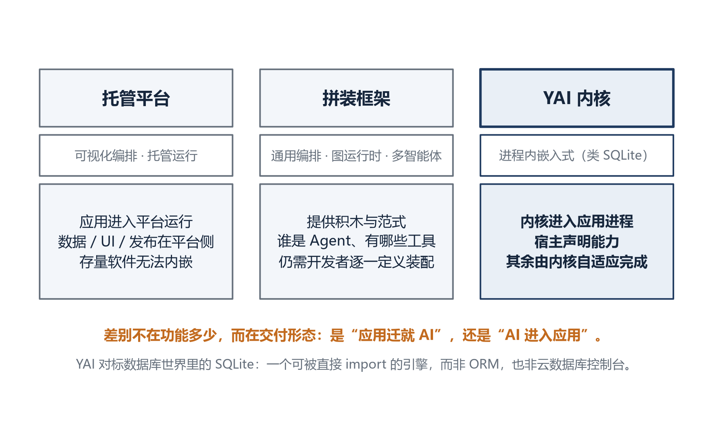
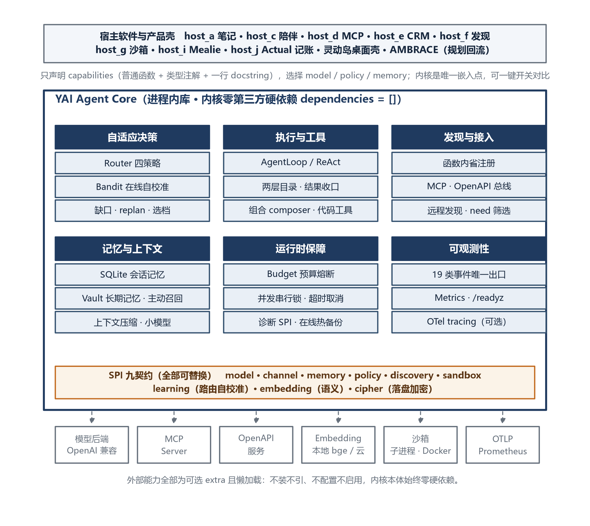
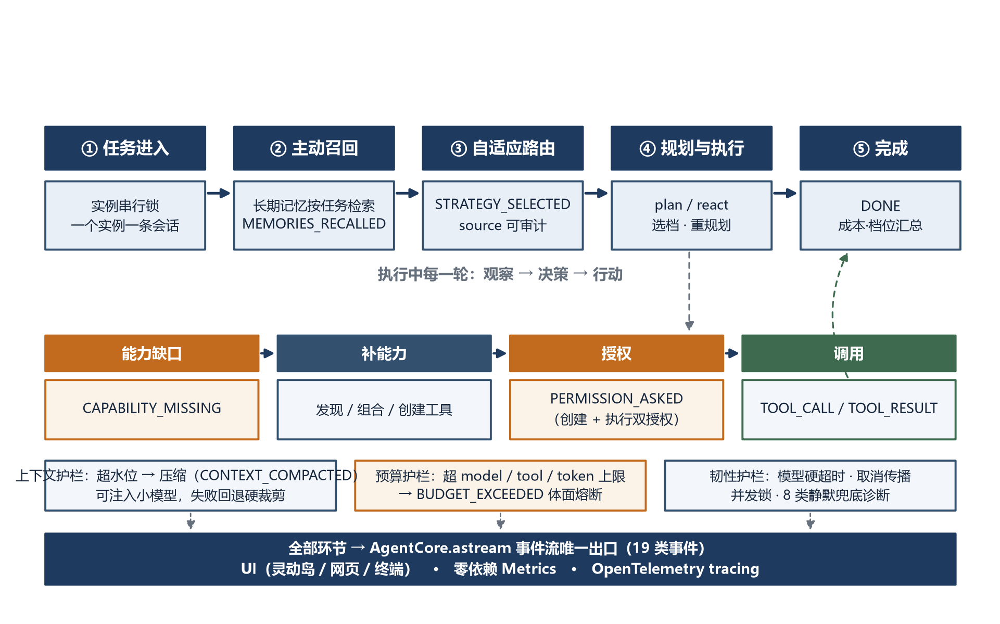
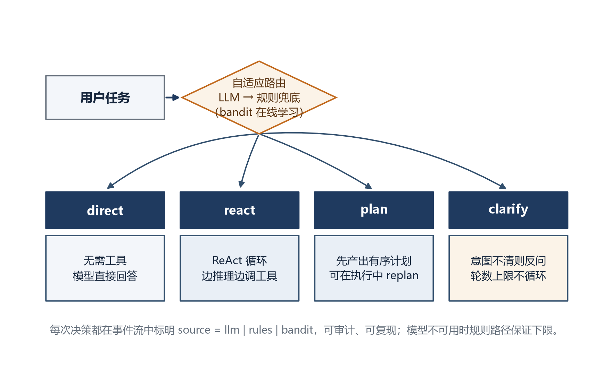
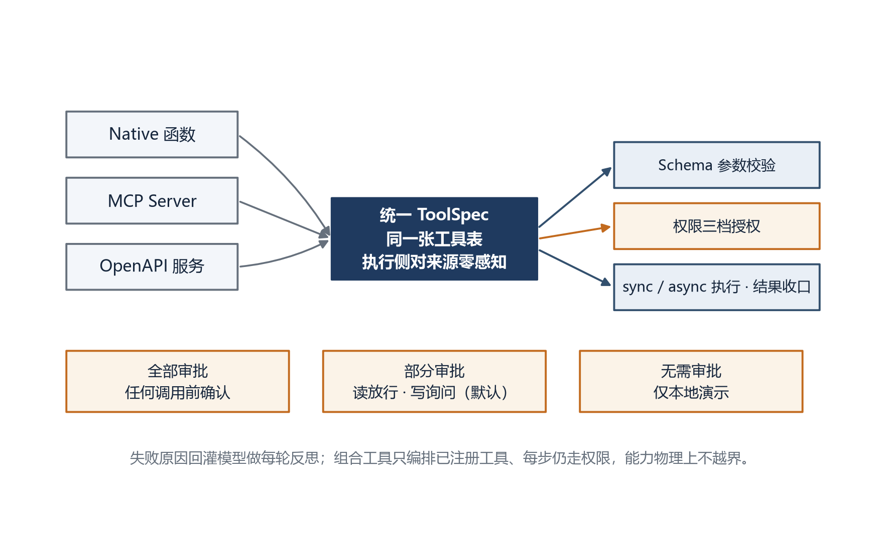
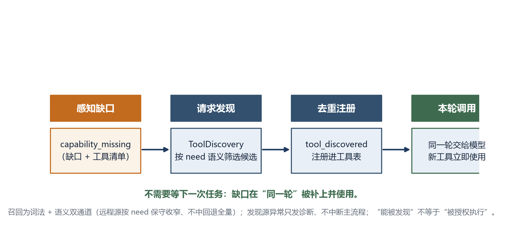
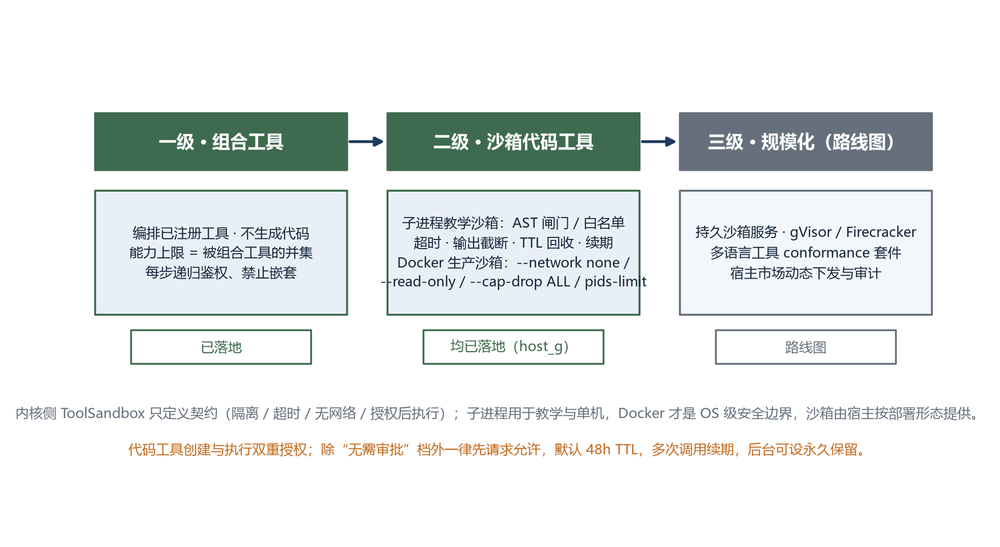
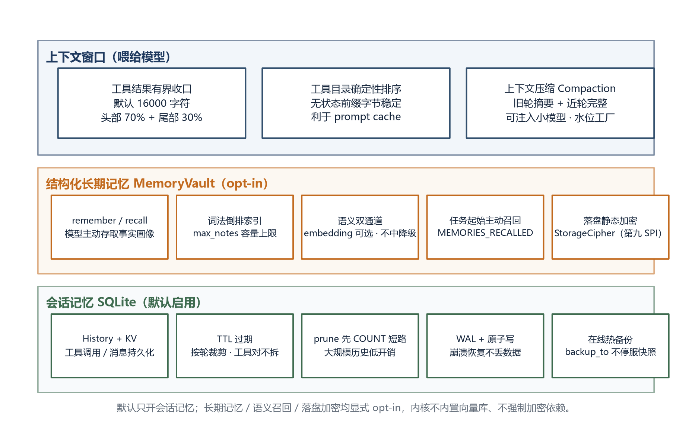
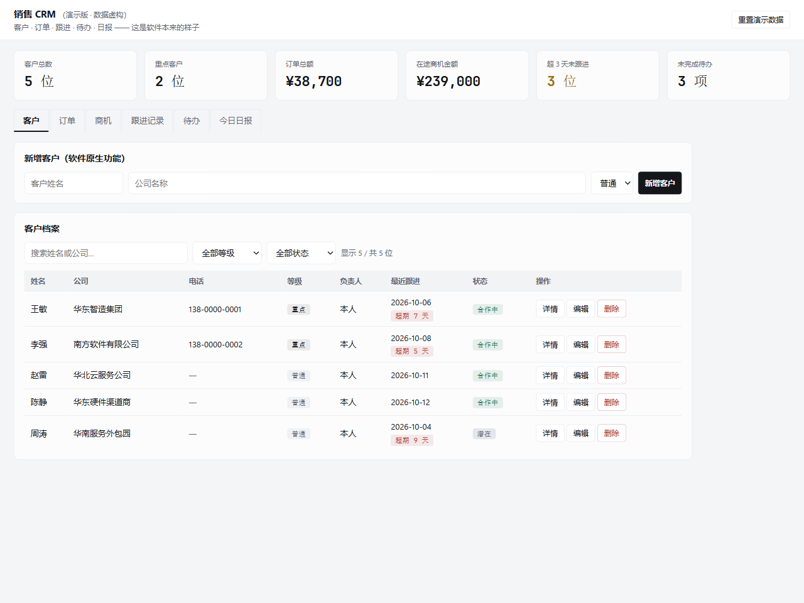
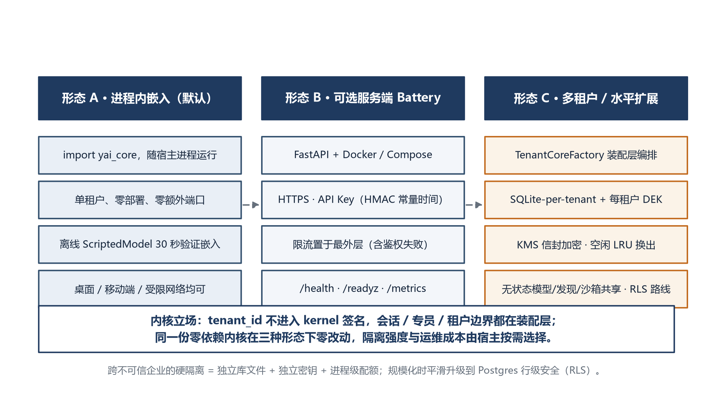

> English translation of [中文](whitepaper.md) · The Chinese version is canonical; if they disagree, the Chinese wins.

# YAI Agent Core

**English** · [简体中文](whitepaper.md)

> An in-process embedded, adaptive Agent kernel — a technical whitepaper

> Author: Gi-Tuu (the single-author open-source project **YAI**)
> Version: v0.25.0　　Document date: October 2026
> Source code: GitHub `Gi-Tuu/yai-agent-core`　·　Gitee `Gi-Tuu/yai-agent-core`
> Package: PyPI `yai-agent-core`　·　License: MIT

> Note: this is a technical whitepaper. It was first drafted at v0.11.0 and has since been continuously updated along with the kernel up to v0.25.0; sections annotated with a version (e.g. 4.12 / 4.13, effective since v0.12) are governed by that section, and the latest version, capability list, and engineering numbers are governed by the [README](https://github.com/Gi-Tuu/yai-agent-core/blob/main/README.md) / [ROADMAP](https://github.com/Gi-Tuu/yai-agent-core/blob/main/ROADMAP.md) / [CHANGELOG](https://github.com/Gi-Tuu/yai-agent-core/blob/main/CHANGELOG.md).

| Item | Description |
|---|---|
| One-line positioning | An in-process Agent kernel that is `import`ed by the host software — "the SQLite of the Agent world" |
| Runtime form | A Python library (≥ 3.11) that runs inside the host process; an optional server-side Battery and a desktop product shell are also included |
| Kernel dependencies | `dependencies = []`; model / Web / MCP / OpenAPI / embedding / encryption and the like are all optional extras, lazily loaded |
| Engineering scale | **On the v0.25.0 release snapshot**: kernel 105 source files / 19 715 lines; tests 127 files / 31 584 lines; 2 075 automated tests (2 070 passed, 5 skipped on environmental conditions), line coverage 95.6% (gate 90%). The numbers measured at the current HEAD are governed by `docs/IMPLEMENTATION_STATUS.md` and CI |
| Contracts and events | 10 replaceable SPI contracts; 21 classes of structured events with a single event exit; 13 optional extras (including the desktop shell and the Anthropic backend) |
| Example hosts | 11 runnable hosts (including 1 production-shaped example), including 2 end-to-end integrations with real open-source software (Mealie, Actual Budget) |
| Supporting artifacts | 55 line-by-line walkthroughs + 1 reading guide, bilingual Chinese/English documentation, Docker / Compose, a desktop Dynamic Island product shell; published up to v0.25.0 (PyPI) |

## Abstract

A great deal of existing software wants to gain Agent capabilities, but the shared premise of mainstream Agent frameworks is "the developer first has an Agent to build, and then goes on to define its tools, workflow, and roles". For software that **already exists** — a note-taking app, a customer management system, a companion app — the question the developer actually faces is: without rewriting the business logic, without introducing a standalone server, and without hand-maintaining a set of Agent loops, how can the software's existing functions be understood, selected, and called "automatically" by an agent?

This paper proposes and implements **YAI Agent Core**: an in-process embedded, adaptive Agent kernel. The host software only needs to declare its existing capabilities in the form of ordinary Python functions with type annotations and docstrings, and the kernel then completes, within the same process, automatic tool registration, adaptive routing, capability-gap awareness and on-demand discovery, memory management, context governance, permission authorization, and full observability. The kernel itself has zero third-party hard dependencies; the ten directions of model, memory, permission, discovery source, sandbox, routing learning, text embedding, storage encryption, and file resources are all exposed as SPI contracts that the host can replace.

We validated the kernel on 11 hosts of different shapes, including end-to-end integrations with two real open-source software products (the recipe manager Mealie and the accounting tool Actual Budget) without modifying their source code; and with a sales CRM host containing no AI code at all plus a standalone desktop "Dynamic Island" product shell, we demonstrated the productization effect of "the host keeps a pure business form while AI is retrofitted as an independent workbench across processes". Engineering-wise, the **v0.25.0 release snapshot** maintains 2 075 offline automated tests and 95.6% line coverage (numbers measured at the current HEAD are governed by `docs/IMPLEMENTATION_STATUS.md` and CI), with production-grade runtime capabilities such as budget circuit breaking, context compaction, cost tiering, structured tracing, readiness probes, and offline evaluation, and it passes OpenSSF Scorecard, CII Best Practices, and a signed release process. This paper systematically sets out its design philosophy, overall architecture, key mechanisms, product forms, engineering governance, and honest boundaries.

**Keywords**: agent kernel; tool calling; capability self-discovery; adaptive routing; in-process embedding; Model Context Protocol; permission governance; open-source software

## 1. Introduction

### 1.1. Background: three delivery forms of Agent capability

At present the ways of delivering large-model capability to software fall roughly into three categories, as shown in Figure 1.



The first is **managed platforms** (the kind that combine visual orchestration, a managed runtime, and an operations back office). They provide visual orchestration, a managed runtime, and an operations back office, and developers configure bots, tools, and workflows inside the platform. Such platforms are feature-complete and quick to start with, but an application must enter the platform's runtime model — data, UI, and release all live on the platform side — so software that already runs independently cannot "embed" such an Agent into its own process.

The second is **assembly frameworks** (the kind that are general orchestration frameworks, graph runtimes, or multi-agent frameworks). They provide excellent building blocks and orchestration paradigms — chains, graphs, state machines, role teams — but "who the Agent is, which tools it has, and in what process it collaborates" still has to be defined and assembled piece by piece by the developer. What a framework answers is "how to build an Agent from scratch", not "how to let an existing piece of software gain Agent capabilities without writing Agent code".

The third category, and the position of this paper, is the **in-process embedded kernel**. It is benchmarked against SQLite in the database world, not against an ORM or a cloud database console: SQLite does not require an application to start a standalone database service; it enters the application process as a library, the application only describes data, and the engine handles storage, retrieval, and transactions. YAI wants to play the same role in the Agent field — the application only declares "what it can do", and the kernel makes those capabilities adaptively usable by the model.

### 1.2. Problem: the engineering cost of "AI-ifying" existing software

Turning an ordinary piece of software into "software with an agent" usually requires, without a kernel, implementing all of the following oneself: model adaptation, the conversation loop, JSON Schema generation for tools, tool selection and execution, planning and reflection, short-term and long-term memory, context-window management, user authorization, capability extension, observability, and safety fallbacks. These capabilities have nothing to do with the specific business, yet they are re-implemented in every application with uneven quality, and they are the main one-off engineering cost of "AI-ifying an application". The market is not short of yet another feature-stacked Agent product; what is missing is a kernel that is **small enough, directly embeddable, and able to grow adaptively along with the host's capabilities**.

### 1.3. List of contributions

The main contributions of this paper are as follows:

1. **An in-process embedded Agent kernel form.** The kernel itself has zero third-party hard dependencies, runs inside the host process as a library, isolates all external dependencies behind ten SPI contracts, and can enter desktop, mobile, and restricted-network environments.
2. **Capability self-discovery and a gap closed loop.** Ordinary host functions are registered automatically through introspection, and MCP and OpenAPI are integrated isomorphically; when the existing tools are insufficient, the kernel senses the gap, discovers on demand, and registers new tools **in the same turn**, and "discovery" is not "authorization".
3. **Self-calibrating adaptive routing.** On top of built-in rules and LLM routing, it offers a contextual-bandit route selector that learns online from execution feedback; it gets more accurate the more it is used on similar tasks, is off by default, has auditable decision provenance, and is reproducible offline.
4. **A three-level growth path for tool capability and a dual-authorized sandbox.** From composite tools that only orchestrate existing tools, to creating code tools in a sandbox, and on to a sandbox service at scale; creation and execution are authorized twice over, and the boundary between the teaching sandbox and the production-grade OS sandbox is honestly separated.
5. **Memory, context, and runtime governance for long-running operation.** Session memory, structured long-term memory, context compaction, cost tiering, budget circuit breaking, session serialization, timeout and cancellation, metrics, and tracing together form a complete production runtime.
6. **Verifiable engineering and security governance.** **v0.25.0 release snapshot**: 2 075 offline tests, 95.6% coverage, 4 fuzz test targets plus offline evaluation, supply-chain signing, and several open-source best-practice certifications, with 11 hosts (including two real open-source software products) proving generality.

## 2. Design philosophy

### 2.1. A SQLite-style self-positioning

YAI deliberately narrows its positioning: it is not a platform for end users to drag and drop Agents together, not a multi-agent collaboration framework, and not an unattended coding agent. It is an **engine**. Design tradeoffs follow one criterion — is this matter "an Agent runtime mechanism that any host needs and that is unrelated to the business"? If yes, it goes into the kernel; otherwise it goes to the host or to an optional extension.

### 2.2. Four design principles

- **A minimal kernel with zero dependencies.** The kernel itself has `dependencies = []`. Model clients, web frameworks, MCP SDKs, HTTP/YAML parsing, local embeddings, encryption, OTel, and the rest all go into optional extras and are lazily loaded inside functions; not installing brings nothing in, not configuring enables nothing.
- **Contractual and replaceable.** Every external direction converges into an SPI: the host can replace the model, memory backend, permission policy, discovery source, sandbox, routing-learning algorithm, embedding model, and encryption implementation, and the kernel is bound to no vendor.
- **Every adaptive decision is visible.** Strategy selection, plans, tool calls, permission asks, capability gaps, tool discovery, context compaction, tier switches, budget circuit breaking, and so on are all emitted as structured events, and the event stream has only one exit; "silent decisions" are forbidden.
- **Honest capability boundaries.** The kernel does not pretend to be omnipotent: when tools are insufficient it reports the gap explicitly, when the sandbox is insufficient against malicious code it states the boundary explicitly, and when the evaluation framing is uncertain it does not advertise absolute numbers.

### 2.3. What it suits and what it does not

YAI suits teams that want to embed Agent capability into an existing or new piece of software, want to keep it running in-process, do not want to introduce and operate a standalone platform, and do not want to write an Agent loop themselves. It does not target visual drag-and-drop assembly, multi-role collaborating multi-agent systems, or long-cycle unattended coding agents; those scenarios have more specialized platforms and frameworks, and Chapter 7 gives honest selection advice.

## 3. Overall architecture

### 3.1. Layered view

YAI's overall architecture is shown in Figure 2, divided top-down into three layers: the host layer, the kernel layer, and the external optional backend layer.



**The host layer** does only two things: declare capabilities as ordinary functions (`capabilities`), and choose the model, permission policy, and memory backend. The kernel is the only embedding point: the host can either import it in-process to gain enhancement, or write no AI code at all and let a standalone desktop Dynamic Island control it across processes over local inter-process communication, so that the difference with and without the kernel can be compared intuitively without changing the host's UI. This paper's 11 example hosts cover notes, companionship, MCP, sales CRM, capability discovery, sandbox, real recipe software, real accounting software, multimodal messaging, and Node Sidecar integration.

**The kernel layer** consists of six groups of mechanisms: adaptive decision-making (routing, self-calibration, gap awareness, replanning, tiering); execution and tools (AgentLoop, the two-level tool catalog, result consolidation, composites and code tools); discovery and access (function introspection, the MCP/OpenAPI bus, remote discovery); memory and context (session memory, long-term memory, compaction); runtime assurance (budget, concurrency lock, timeout, diagnostics, hot backup); and observability (events, metrics, tracing, readiness probe). Cutting across these six groups of mechanisms are the **10 SPI contracts**.

**The external backend layer** is entirely optional: OpenAI-compatible model services, MCP Servers, OpenAPI services, local or cloud embedding models, subprocess/Docker sandboxes, and OTLP/Prometheus observability endpoints. They are accessed through extras and SPIs, and when missing the kernel degrades rather than erroring.

### 3.2. The ten SPI contracts

The kernel defines its boundary with the outside world through ten protocols (Protocol), detailed in Appendix B: model `ModelProvider`, channel `Channel`, memory `MemoryStore`, permission `PermissionPolicy`, discovery `ToolDiscovery`, sandbox `ToolSandbox`, routing learning `RouteSelector`, text embedding `EmbeddingProvider`, storage encryption `StorageCipher`, and file resources `ResourceProvider`. This design lets the same kernel move smoothly between "an offline script with zero external dependencies" and "a server connected to full cloud services", with zero changes to kernel code.

### 3.3. The single exit of the event stream

All the signals the kernel produces in one run — strategy selection, plan creation and revision, model messages, tool calls and results, permission asks and permission denials, clarification requests, capability gaps, tool discovery/composition/creation and retirement, context compaction, memory recall, host real-time state, tier switches, budget overruns, errors, and completion — 21 classes of events in total (Appendix A), are produced uniformly by `AgentLoop` and emitted outward through the single exit `AgentCore.astream`. The UI, logs, metrics, and tracing all exist as subscribers to the events, which architecturally rules out bypass output and unobservable decisions.

### 3.4. The lifecycle of a run

A task's complete lifecycle inside the kernel, together with the runtime guardrails, is shown in Figure 6: after a task enters, it first acquires an instance-level serialization lock, then proactively recalls long-term memory for the task and enters adaptive routing; routing chooses among direct / react / plan / clarify, the plan strategy can replan dynamically during execution, and the react loop observes, decides, and acts round by round; when a capability gap appears it enters the "discover/compose/create — authorize — call" sub-flow; when the context exceeds the watermark, compaction is triggered; when the budget is exceeded, a graceful circuit break is triggered; model calls have a hard timeout and cancellation propagation; finally a `DONE` event outputs the result and summarizes cost and tiers. All events flow into the single exit for consumption by the UI, metrics, and tracing.



## 4. Key mechanisms

### 4.1. Adaptive routing and online self-calibration

At the start of every task the kernel chooses an execution strategy, as shown in Figure 3: small talk that needs no tools goes `direct`; work that needs reasoning and tool calls interleaved goes `react`; multi-step tasks with ordering dependencies go `plan` and first produce an ordered plan; when the intent is unclear it goes `clarify` and asks back, with a round cap to avoid endless questioning.



Routing has three layers, and **the decision provenance is always recorded in the event**: zero-cost Chinese/English rules serve as the deterministic fast path and the final fallback; optional LLM classification provides a semantic judgment when the rules are uncertain, and falls back to the rules automatically when the model is unavailable or its output is invalid; on top of both, the `RouteSelector` SPI provides a **contextual bandit** that learns online from execution feedback — it buckets tasks by feature, accumulates the posterior of a Beta distribution, and picks a strategy for similar tasks with Thompson Sampling; on cold start it deterministically follows the rules, only samples after real success/failure feedback has accumulated, and abstains in hard-rule regions. This mechanism puts the "self-adaptive" in the project name into practice: routing is not a one-shot open-loop classifier but a closed loop that gets more accurate with use. Learning is off by default, the algorithm is replaceable, and the built-in five-line offline benchmark (including the "no prior" and "no context" ablations) reproducibly shows a success rate of 89.6% for learned routing versus 73.3% for fixed rules on late-stage tasks; the script carries a hard check that "learning must be significantly better than rules", the numbers are produced by CI, and no manual polish is applied.

### 4.2. A unified tool bus and the three permission tiers

The three kinds of tool sources — host-native functions, external MCP Servers, and OpenAPI services — are normalized into the same `ToolSpec` at registration and enter the same tool table, and the execution side is unaware of the tool's source, as shown in Figure 5. Native functions automatically generate a JSON Schema through introspection of type annotations and docstrings; the MCP Client and the OpenAPI adapter translate external capabilities into the same structure. Before execution every tool call passes through Schema validation, permission authorization, and sync/async execution, and the failure reason is fed back to the model for round-by-round reflection.



Permission is decided by the `PermissionPolicy` SPI, which offers three tiers: **approve everything** (confirm before any call), **approve some** (read-only operations pass, write operations and new capabilities ask; the default), and **no approval** (local demos only), plus allowlist support. Composite tools are authorized recursively at every step, so their capability ceiling physically cannot exceed the union of the tools they compose.

### 4.3. Capability-gap awareness and on-demand discovery

When the model judges that the existing tools are insufficient to complete the task, the kernel does not pretend the tool exists or call it blindly; it emits a `capability_missing` event carrying the gap description and the current list of available tools. If the host has injected a `ToolDiscovery` discovery source, the kernel requests discovery **in the same turn**, registers the result after de-duplication (emitting `tool_discovered`), and hands the new tool to the model for use, as shown in Figure 4.



Discovery matching uses a **lexical + semantic dual channel**: the lexical channel has zero dependencies, supports Chinese bigrams and synonyms, and is always available; the semantic channel optionally uses an embedding model and computes similarity with the standard-library cosine (without bringing numpy into the kernel), and uses an "absolute threshold + top1 margin" strategy to avoid false recall among a pile of similar candidates, degrading automatically to pure lexical when the embedding backend is missing or errors. For remote discovery sources, the kernel performs a conservative narrowing on both the lexical and the semantic side against the task `need` (threshold 0.20, margin 0.08, top_k 8), falling back to the full catalog when nothing matches, balancing recall and precision. An exception in a discovery source only produces a diagnostic event and does not interrupt the main flow. **"Can be discovered" and "is authorized to execute" are strictly separated**: the first call of a newly discovered tool still has to pass the permission gate.

### 4.4. Three-level tool capability growth and dual sandboxes

The kernel divides "extending its own capabilities" into three levels, as shown in Figure 8.



- **Level 1 · composite tools (shipped)**: the model orchestrates several registered tools into one new tool, generating no code, with recursive authorization at every step, nesting forbidden, and high safety.
- **Level 2 · sandboxed code tools (shipped)**: the model creates temporary Python tools inside a sandbox. The kernel-side `ToolSandbox` only defines the contract (isolation, timeout, no network, execute after authorization), and the concrete implementation is supplied by the host: the teaching subprocess sandbox ships an AST gate (rejecting import nodes and underscore attribute access, truncating known introspection escapes), an allowlist, timeouts, and output truncation; the production Docker sandbox forms a genuine OS-level boundary with `--network none`, `--read-only`, `--cap-drop ALL`, `--no-new-privileges`, and `--pids-limit`. Code tools are **authorized twice, at creation and at execution**: except in the "no approval" tier, permission is requested first; temporary tools live 48 hours by default (TTL), are renewed when called repeatedly, and the user can also set them to be kept permanently in the background.
- **Level 3 · at scale (roadmap)**: a persistent sandbox service, stronger isolation such as gVisor/Firecracker, a cross-language tool conformance suite, and dynamic delivery from a host marketplace.

The kernel honestly distinguishes two kinds of sandbox: the subprocess sandbox is for teaching and single-machine demos and is not treated as a security boundary against malicious code; the Docker sandbox is the OS-level isolation for production.

### 4.5. Three-layer memory and context governance

Aimed at long-running digital employees, the kernel splits "what to remember and what to feed the model" into three layers, as shown in Figure 7.



- **Session memory (on by default, SQLite)**: persists messages, tool calls, and key-value state; supports TTL expiry and trimming by conversation turn (a tool call and its result are never split apart); `prune` short-circuits with a COUNT first to keep overhead low on large histories; uses WAL and atomic writes for crash recovery, and supports online hot backup with `backup_to` without downtime.
- **Structured long-term memory (opt-in, MemoryVault)**: the model proactively deposits and retrieves facts and profiles through the `remember` / `recall` tools; underneath it maintains a lexical inverted index and a `max_notes` capacity cap, and can optionally attach embeddings for semantic dual-channel recall; at the start of every task it can automatically recall relevant long-term memories for that task (emitting `MEMORIES_RECALLED`); what is written to disk can be encrypted at rest through the ninth SPI, `StorageCipher` (a Fernet implementation).
- **Context-window governance**: tool results are uniformly bounded and consolidated (16 000 characters by default, keeping the first 70% and the last 30%, with `truncated` and the actual character count marked in the event); the tool catalog is deterministically sorted by name so that the stateless prefix is byte-stable and friendly to prompt caching; when the history approaches the window watermark, context compaction runs (a summary of older turns plus complete recent turns), compaction can be routed to a dedicated smaller and cheaper model, and a watermark factory that generates policies per context window is provided; if compaction fails it falls back to hard truncation, and a `CONTEXT_COMPACTED` event is emitted throughout.

Long-term memory, semantic recall, and encryption at rest all have to be enabled explicitly; the kernel does not build in a vector database and does not force an encryption dependency.

### 4.6. Plans, replanning, and cost/latency tiering

The `plan` strategy first generates an executable ordered plan; during execution, if a prerequisite step is found to be missing or the tool results indicate that an adjustment is needed, the model can revise the plan through a dedicated replanning meta-tool (emitting `PLAN_REVISED`); this action has no external side effects and does not go through tool authorization. Under the built-in zero-dependency **tiering** mechanism, the kernel uses the standard-tier model by default and upgrades to the strong-tier model only at moments that need more reasoning — planning, course correction, and entering the third round — emitting `TIER_CHANGED`, and summarizes the standard-tier/strong-tier call counts in the `DONE` event, thereby controlling cost without sacrificing the quality of key decisions.

### 4.7. Budget, concurrency, and resilience

Aimed at the real demands of "afraid of runaway spending" and "running unattended for a long time", the kernel provides task-level **budget circuit breaking**: it can separately limit model calls, tool calls, and token usage, and on exceeding a limit it emits `BUDGET_EXCEEDED` and terminates gracefully. For runtime resilience, each kernel instance holds an async lock to serialize sessions (one instance handles only one session at a time), model calls have a configurable hard timeout and propagate cancellation correctly, and there are eight classes of zero-dependency silent-fallback diagnostic SPIs that turn failures of external dependencies such as the model, discovery sources, and sandboxes into readable diagnostics rather than stack traces. Configuration is centralized in `CoreConfig` with `from_config` assembly and startup-time validation. Sub-employees (see 5.3) carry a hard budget by default and are constrained in total by the global `DelegationSupervisor` concurrency gate (at most 5 parallel subtasks by default, shared across levels).

### 4.8. Observability and offline evaluation

The kernel builds in a zero-dependency `MetricsRecorder` without depending on any monitoring vendor, and exposes `/readyz` and `/metrics` probes (JSON supported); subscribing to the event stream yields an OpenTelemetry metrics bridge (the `[otel]` extra). Structured tracing wraps one run in a root span `yai.agent.run`, implemented by subscribing to `astream` on the outside, without intruding into the kernel. In addition, an offline evaluation package is provided: it collects execution traces with golden tasks (GoldenTask), scores each task, and aggregates the scores, running as a non-gating evaluation job in CI; its framing stays honest — the evaluation measures routing strategy and chain correctness, and does not advertise absolute metrics such as a "hallucination rate" that cannot be guaranteed.

### 4.9. Declaration-driven permission governance (argument-level approval, capability gate, and resource scoping)

This group of mechanisms answers the same question: **can "a human must confirm this" be written down by the host, enforced by the kernel, and be visible in the audit log**? Its core discipline is that "security semantics come only from declarations, never from guesses", and there is only one direction — **a declaration can only raise the gate, never let something through in place of the host's permission policy**.

- **Argument-level approval (kernel-native)**: the host expresses "anything beyond this line needs human confirmation" by writing data for a tool — `ApprovalPolicy(when=(ApprovalRule("amount", ">", 1000),))`. The judgment semantics are strict: comparisons perform no implicit cross-type conversion (`"1000" != 1000`, otherwise a string argument could slip past the amount threshold); anything that cannot be judged (an unknown operator, a condition path not declared in the bound schema, a non-finite number met by a numeric comparison) **fails closed as a denial**, and is never let through by "treating the condition as not matched". Order is also semantics: argument validation comes before conditions, unconditional requirements (`required`) take precedence, and multiple conditions take ANY. Because it is only data, it travels across processes and languages with the capability manifest, and the importing side can restore this enforcement without any external protocol; when the manifest contains a field the kernel does not recognize, loading is **rejected outright** — silently ignoring it would amount to "protection was declared but the kernel did not do it".
- **Capability gate (gate) and trusted subject**: a tool can carry its own decision closure `(arguments, subject) -> GateDecision`, supplied by the host or the integration layer; **the kernel imports no protocol implementation** and only acts on three answers: deny / ask a human / silence. `subject` is the operating subject injected by the host, passed through the call chain each time and never stored on instance attributes (so concurrent sessions do not stick to each other); therefore "this run has no subject" is denied outright, and **the identity of the previous caller is never reused**; the subject is handed only to policies that declared the capability flag, and the kernel does not pretend on a policy's behalf that it understands identity. The identity at this layer is "injection + passthrough + admission", not authentication.
- **External capability contract (optional interoperability layer)**: the external ecosystem attaches governance labels to its own APIs (risk / approval intent / audit sensitivity), and the project provides a zero-dependency declaration validator and OpenAPI binding: when the declaration format is wrong, the major version is unknown, or a conditional argument cannot be parsed, **the whole operation is skipped and a diagnostic is left**, and it never falls back to "a same-named tool without governance". The 26 upstream conformance vectors are checked into the repository byte-for-byte with hashes, and the corpus is not distributed with the package. The only external statement is one line: *Implements the ACC v1 OpenAPI Binding Parser Profile* (the specification explicitly forbids "certified"-style wording); since v0.12, `timeout_ms` / `rate_limit` have been genuinely enforced by the executor — calls that exceed the timeout or the rate limit do not enter the business handler (see 4.12).
- **Resource scope gate**: the two path gates of the file capability only govern "does it leave the root directory"; they cannot govern "which part inside the root directory". The new gate uses **exactly the same** path-normalization function as the handler, so "the approved target == the executed target" holds by construction rather than by convention — otherwise the model could write `./notes//a.txt` to slip past an allowlist that matches the raw string, and that raw string is exactly what the human approval saw.
- **Decision results must be visible**: risk, scope, and the actual target (`risk` / `scope` / `target`) are emitted with the `PERMISSION_ASKED` and `TOOL_CALL` events, so that human approval has a basis for judgment and later audit can query by risk; empty values do not write the key, and the event shape of ungoverned tools is byte-for-byte unchanged. The kernel does **not** automatically raise or lower tiers by risk — that is the host's permission model.
- **Argument snapshots share one source**: policy judgment and actual execution share the same authoritative snapshot; what is shown to humans and written into the audit is a read-only copy derived from it; during confirmation a channel may rewrite its own copy, which can change neither the execution nor the events already emitted. Redaction follows declared paths (`[redacted:len=N]`; the length is kept because the approver needs to judge "is this a long token I recognize?"), and the broad-scope audit hint only touches the audit copy, without smudging the copy the approver needs to see.

The other security mechanisms running through the tool chain remain unchanged: API keys are compared in constant time with `hmac.compare_digest`, and when unconfigured authentication is off by default with a prominent warning in the documentation; the rate-limiting middleware sits at the outermost layer, so requests that fail authentication are also counted towards the rate; response bodies have a size guard; all SQLite access is parameterized; the SSRF surface is narrowed by having the host configure base_url, path encoding, and not following redirects; code tools are authorized both at creation and at execution, and high-risk capabilities ask by default. Chapter 8 further explains which mechanisms are security boundaries and which are not.

### 4.10. Capability declarations across processes

Tool specs can be exported as a language-neutral, JSON-serializable capability manifest: a composite's workflow steps and a code tool's code are both data and travel with the manifest; `handler` and `gate` are runtime functions and are **neither exported nor ever rebuilt from a declaration snapshot in the manifest** — foreign JSON can neither add a function-level gate to a local tool, nor is there any channel that removes an already-bound gate on the local side; to restore admission the host must explicitly rebind locally. No second call protocol is invented on top of the manifest: to actually call across languages, let the other side expose MCP or OpenAPI — that is already their remit.

### 4.11. Other security mechanisms

The general security mechanisms running through the tool chain: API keys are compared in constant time with `hmac.compare_digest`, and when unconfigured authentication is off by default with a prominent warning in the documentation; the rate-limiting middleware sits at the outermost layer so that requests failing authentication are also counted towards the rate, avoiding online brute forcing — **its threat model is honestly written as "preventing accidental hammering"**: the client identity is taken from the leftmost `X-Forwarded-For` entry, so it does not defend against deliberate forging of forwarding headers, and that tier relies on authentication rather than this layer; response bodies have a size guard; all SQLite access is parameterized; the SSRF surface is narrowed by having the host configure base_url, path encoding, and not following redirects; code tools are authorized both at creation and at execution, and high-risk capabilities ask by default. Chapter 8 further explains which mechanisms are security boundaries and which are not.

### 4.12. Declarations as constraints: governance hints are actually enforced (since v0.12)

v0.11 brought argument-level approval, admission decisions, and redaction back into the kernel natively (4.9); v0.12 goes on to answer a harder question — **are the hints in a declaration actually enforced?**

Before v0.11, the enforcement hints in an external capability contract (the per-call timeout cap and rate cap) were **only parsed, never enforced**: the declaration said "10 seconds per call" and "30 times per minute", yet the kernel acted as if they did not exist. Since v0.12 they are translated into kernel-native enforcement policies (data) and enforced by the executor:

- **Timeouts** take **the stricter** of the call-level and the global caps (governance data can only tighten, never loosen, the guardrails);
- **Rate caps** use an in-process sliding window; calls over the limit **do not enter the business handler** and produce no "a call happened" audit record, and the decision is made **before requesting human approval** (one should not first ask a human to approve a call that will not execute);
- **Trusted-subject requirements** no longer "hide" a capability ahead of time at registration; instead they are judged **per call at execution time**: the subject is injected by the host at run time, so at registration time there is no way to know whether this run will have a subject, and hiding a capability early behind a static boolean would make the subject useless at registration time.

Accompanying this is one piece of **adversarial evidence**: even if `timeout_ms` / `rate_limit` / `governance` are stuffed into a tool's arguments, they **cannot change** any governance conclusion — governance comes only from the declaration attached to the tool at registration, while arguments are a model artifact.

The same batch also fixed three silent failures where "there appeared to be a guardrail but it was not in effect": the array-nested path of argument-level approval **never matched** (path resolution was written twice — the schema side recognized it while the value side did not, so the condition never triggered); the empty-string prefix of the scope gate once meant "the entire root directory is writable"; and tool return values were not redacted, so a secret could come back into the event stream from the result side. Each has a regression test that spells out "what it looked like before the fix".

### 4.13. Multimodal message contract (optional extension, since v0.12)

Before v0.11 the message contract was plain text (`content: str`); since v0.12 an **optional** part extension (`ChatMessage.parts`) is added, with three rules running through it:

- **Default unchanged**: when `parts` is empty, outbound messages are **byte-for-byte identical** to the previous version (pinned by a test), and existing hosts need zero changes;
- **Both "visible" and "invisible" are stated clearly**: only **inline** images are actually seen by the model; reference-only parts are rendered as a placeholder that **states outright that the model cannot see them** — **images are never silently dropped** (when material is missing, the model still answers as usual: it looks like success but is actually a wrong answer). The kernel **does not fetch** any external resource reference for the host (that is an authorization and lifecycle question);
- **No large binaries resident long-term**: only references and metadata are persisted to disk, image bytes never enter the history; inline payloads have a separate hard cap (an oversized image both burns money and may blow up the request).

Degradation and summarization do not lose information either: when handing a part to a model that does not support multimodality or to a plain-text summarizer, the part is rendered as **information-preserving text** (if image references were silently dropped, facts like "the user sent a screenshot, and the conclusion is…" would vanish into nothing).

## 5. Product forms and scenario validation

### 5.1. One kernel, many hosts

The kernel is validated on 11 runnable hosts, covering the spectrum from teaching examples to real open-source software:

| Host | Type | Main verification points |
|---|---|---|
| host_a notes | native functions | automatic registration through function introspection; memory tools |
| host_c companion | native functions | emotional and memory capabilities in a companion scenario (the AMBRACE concept prototype) |
| host_d MCP | MCP Client | the isomorphic tool bus for connecting external MCP Servers |
| host_e sales CRM | pure-host vertical product | a pure-stdlib HTTP tool service with zero AI UI, driven across processes by the Dynamic Island; customers/opportunities/orders |
| host_f discovery | ToolDiscovery | semantic filtering of remote discovery sources by need, and same-turn registration |
| host_g sandbox | dual sandboxes | the subprocess teaching sandbox and the Docker production sandbox, code tool TTL |
| host_i Mealie | real open-source software | end-to-end OpenAPI integration with the recipe manager Mealie |
| host_j Actual | real open-source software | third-party seeding of, and sub-employee delegation for, the accounting software Actual Budget |
| host_k multimodal | native functions + resource references | multimodal message parts (inline images / resource references) and host-side scope decisions |
| host_l Sidecar | language-agnostic host | a Node process carrying Agent sessions over stdio NDJSON + JSON-RPC 2.0 |
| host_production production-shaped | production host integration | an integration example of API Key authentication, global rate limiting, readiness probes, and production-safe defaults |

### 5.2. A pure-host facade: a zero-AI-code sales CRM, controlled across processes by the Dynamic Island

host_e is a self-contained sales CRM: customers, orders, opportunities, follow-up records, to-dos, and daily reports, with statistic cards, search and filtering, and data persistence, and **the entire web page contains no AI code or AI UI** — no chat box, no toggle; it is itself a complete, independently usable business system, as shown in Figure 10. Agent capability is provided entirely by the standalone desktop Dynamic Island: after selecting "销售专员" ("Sales Specialist") in the Dynamic Island, the kernel calls the 24 business tools that the CRM exposes through a pure-stdlib `ToolService` over local HTTP (127.0.0.1:8200); a single sentence from the user can add a customer, enter an order, or look up a record, and the CRM page automatically refreshes with the new data through periodic polling, as shown in Figure 11. When a task needs a capability the CRM does not originally have (such as looking up the weather at a visit site, or computing a tax-inclusive price by tax rate), the kernel senses the capability gap, discovers `get_visit_weather` and `calc_quote_with_tax` from the host's on-demand catalog, and requests authorization. This form proves the kernel's position more thoroughly than an "in-app toggle": **the host can have zero AI code, and the Agent is a cross-process intelligent kernel that can be retrofitted and that runs independently**.




### 5.3. Desktop product shell: the Dynamic Island and sub-employees

To show that the kernel need not depend on the host building its own interaction window, the project ships a desktop "Dynamic Island" product shell (PySide6): at rest it is a draggable floating ball summoned by a global hotkey (Ctrl+Alt+Y) (Figure 12), and when expanded it becomes a lightweight workbench (form shown in Figure 11). The top of the workbench gathers settings such as the Core switch, the approval tier, tool management, learning status, and auto-retract; the left side holds, in a collapsible single row, multiple host "specialists" such as sales, warehouse, notes, and companion, and the user switches specialists within the same panel to handle affairs in different software. The "Sales Specialist" among them depends on no in-process assembly; it connects across processes over local HTTP to a zero-AI-code sales CRM (host_e, §5.2), completing operations such as creating customers, entering orders, and looking up records inside the floating window, while the CRM web page itself stays unchanged. This expresses the relationship of "an independent kernel with the Dynamic Island integrating multiple hosts": multiple applications each run on their own, and the Dynamic Island acts as a unified conversational front end that connects on demand, rather than being an attached chat box of some single application.


On top of the Dynamic Island and host_j, the kernel supports **sub-employee delegation**: a host specialist can delegate read-only subtasks to sub-employees in parallel, and sub-employees carry a hard budget by default and are constrained by the global concurrency gate. host_j covers both the capability-discovery chain and the sub-employee delegation chain with a single "five-beat standard line", and pins the behavior with 17 offline tests.

### 5.4. Third-party seeding of real open-source software

What best demonstrates generality is the integration with two real open-source software products unrelated to this project. host_i targets the recipe manager Mealie, registers tools automatically from its OpenAPI description, and completes real queries in an actually running Docker environment; host_j targets the accounting software Actual Budget and completes accounting tasks through its official command-line capability (as subprocesses with an injectable runner; neither the kernel nor the example introduces a Node dependency), and a complete offline Fake replay keeps CI free of network dependencies. Neither **modifies the other side's source code**; both only "seed" the kernel by declaration/adaptation, which validates the kernel's adaptation cost for existing software.

### 5.5. Deployment forms and multi-tenancy

The same zero-dependency kernel supports three deployment forms, as shown in Figure 9: the default in-process embedding (zero deployment, zero extra ports), the optional FastAPI server Battery (Docker/Compose, HTTPS, API Key, rate limiting, response guard, and health/readiness/metrics probes), and a SaaS-oriented multi-tenant/horizontally scaled form. In the kernel's position, `tenant_id` does not enter kernel function signatures; sessions, specialists, and tenant boundaries are all **assembly-layer** responsibilities: the reference implementation gives SQLite-per-tenant, per-tenant data encryption keys (DEK) envelope-encrypted via KMS, LRU eviction of idle instances, and shared stateless model/discovery/sandbox, along with a route for upgrading to Postgres row-level security (RLS) at scale. The same kernel needs zero changes across the three forms.



## 6. Engineering quality and open-source governance

### 6.1. Testing and quality gates

**v0.25.0 release snapshot**: the project maintains 2 075 automated tests (2 070 passed, 5 skipped for environmental conditions such as no Docker daemon or no local model weights), all running offline without depending on the network or an API Key; line coverage of the kernel is 95.6% (gate 90%), and CI has a 90% coverage floor (numbers measured at the current HEAD are governed by `docs/IMPLEMENTATION_STATUS.md`). Tests generally use fake models (ScriptedModel), mock transports, and an injectable clock, so that behaviors such as adaptive routing, the discovery closed loop, and budget circuit breaking can all be reproduced deterministically. Continuous integration runs Ruff, mypy, and pytest on Ubuntu with Python 3.11/3.12/3.13 and on Windows with Python 3.13; there are also 4 fuzz test targets (schema, compaction, features, sandbox static gate; non-gating), a routing benchmark curve job, and an offline evaluation job.

### 6.2. Supply-chain security and best practices

The release pipeline generates SLSA provenance for build artifacts and performs keyless signing with cosign, and PyPI uses OIDC-based trusted publishing; GitHub Actions are all pinned to commit SHAs with minimal permissions granted, and Dependabot and CodeQL are enabled. The project has passed OpenSSF Best Practices (CII) at the Passing level and achieved good results in the OpenSSF Scorecard, with full marks on token permissions and pinned dependencies. The security reporting process is specified in `SECURITY.md`.

### 6.3. Documentation and learnability

Considering that the project is also the vehicle the author builds while learning, the repository provides 55 line-by-line walkthroughs, ranging from the minimal kernel all the way to context compaction, memory-scale governance, concurrency diagnostics, structured tracing, and third-party seeding, together with bilingual Chinese/English README, architecture, comparison, deployment, and security documents, plus CONTRIBUTING and Issue/PR templates. The kernel stays zero-hard-dependency and small, and is itself a readable sample for learning about Agent runtimes.

## 7. An honest comparison with peer approaches

Table 1 gives the comparison based on each approach's self-positioning in its official documentation and on verifiable facts in this repository, without disparaging comparisons.

**Table 1　Comparison across key dimensions**

| Dimension | YAI Agent Core | General/graph orchestration frameworks | Multi-agent frameworks | Self-hosted platforms | Managed no-code platforms |
|---|---|---|---|---|---|
| Delivery form | A library that is imported and runs with the host process | Library/framework | Library/framework | Self-hosted server platform | Managed SaaS |
| Embedding into existing software | In-process import, the only embedding point, switchable | You must assemble the loop yourself | The multi-agent paradigm requires application cooperation | The application becomes a platform client | Cannot be embedded |
| Kernel runtime dependencies | None (dependencies=[]) | Layered dependency packages | Framework dependencies | A full server stack | None (platform-hosted) |
| Tool access | Introspection + MCP + OpenAPI + an on-demand discovery closed loop | Tool abstractions and integration packages | Tool abstractions | In-platform tools/marketplace | Platform plugin ecosystem |
| Tool-discovery matching | Lexical + semantic dual channel, with thresholds and a margin against false recall | Mostly manual binding, or dumping everything into the prompt | Not built in | A fixed tool set selected by name | Platform marketplace |
| Route self-calibration | Contextual-bandit online learning (off by default, reproducible) | Must be built yourself | None | None | None |
| Multi-agent | Explicitly not doing (a host-layer concern) | Can be built yourself | Native strength | Supported | Native |
| Decision observability | 21 classes of events through a single exit | Depends on external services | Framework logs/external | Platform logs | Built into the platform |
| Offline testability | The full test suite is offline, no key needed | You must mock yourself | You must mock yourself | Depends on the platform | Depends on the platform |

YAI's differentiating claim can be summarized as: in paradigm, a reversal from "assembly framework" to "embedded kernel"; in capability, self-discovery rather than manual registration; in routing, a capability-gap closed loop and online self-calibration; in engineering, zero hard dependencies plus ten replaceable contracts. Correspondingly, whoever needs visual drag-and-drop assembly should choose the platform category, whoever needs multi-role collaboration should choose the multi-agent framework category, whoever needs fine-grained graph orchestration should choose the graph-runtime category, and whoever needs the richest integration ecosystem for a quick prototype should choose the general framework category; whereas embedding Agent capability into existing software, keeping it in-process, and not writing an Agent loop oneself is exactly YAI's position. It should be noted that YAI is a new single-author project, and its maturity and ecosystem scale cannot be equated with the mature products above; this boundary is stated explicitly in Chapter 8.

## 8. Honest boundaries

- **Maturity and ecosystem**: the project is a new single-maintainer project; test coverage and engineering governance are relatively mature, but third-party adoption, the plugin ecosystem, and the long-term iteration history are still at an early stage.
- **Explicitly not done**: the kernel does not provide an MCP Server, multi-agent orchestration, a built-in UI (the Dynamic Island is a separate product shell, not the kernel), an unattended coding agent, or a built-in vector database, nor does it bundle a production sandbox executor (it only defines the contract).
- **Sandbox boundary**: the subprocess teaching sandbox has an AST gate and an allowlist, but is not regarded as a security boundary against a malicious or manipulated model; production isolation should use an OS-level sandbox such as Docker.
- **Evaluation framing**: the 89.6% versus 73.3% numbers only measure how a routing strategy performs on a fixed benchmark; they do not represent end-to-end task success rate, let alone a hallucination rate; the semantic-recall thresholds are calibrated against the local bge-m3 and may change with a different model.
- **Optional capabilities**: long-term memory, semantic recall, encryption at rest, OTel, and server-side authentication are all explicit opt-ins; the server has authentication off by default when no key is set, and a public deployment must configure it itself.
- **Multi-tenancy**: the kernel does not build in tenant isolation; hard isolation across untrusted tenants (separate database files, separate keys, per-process quotas, even Postgres RLS) is borne by the assembly layer.
- **Online demo**: the free hosting tier has cold-start latency, and the demo data is fictional.
- **Scope of the external capability contract**: the optional interoperability layer only covers declaration validation and OpenAPI binding, and externally claims only *ACC v1 OpenAPI Binding Parser Profile*; since v0.12, `timeout_ms` / `rate_limit` have been genuinely enforced by the executor (calls over the timeout or rate limit do not enter the business handler), but risk level and scope remain **descriptive** fields (the kernel does not automatically raise or lower tiers by risk), and the trustworthiness of a subject comes entirely from whether the host grants it within its own trust boundary — the kernel neither verifies signatures nor issues tokens.
- **Boundaries of argument-level approval**: approval looks only at arguments, not at "whether this subject actually has permission on this resource"; the resource scope gate gives a scope, not an authorization model. Cross-tenant and per-subject fine-grained authorization still belong to the host.

## 9. Future work

Near-term work includes: publishing a persistent sandbox service reference implementation and gVisor/Firecracker adapters, a cross-language tool conformance suite, a ToolDiscovery ecosystem marketplace index, and reference implementations for multi-tenant Postgres RLS and a mobile shell. The v1.0 goal in the milestone sense is to re-embed the matured kernel into the author's open-source AI companion project AMBRACE, so that it gains tool calling, memory, planning, proactive behavior, and limited autonomous operation while keeping its companion positioning; until both sides (kernel and host) are ready, the version will stay below 1.0, and 1.0 will not be released early.

## 10. Conclusion

YAI Agent Core tries to prove one concrete thing: Agent capability can, like a database engine, enter any software as a library that is small enough, has zero hard dependencies, and a clear contract, growing adaptively along with the capabilities the host declares — sensing gaps, filling capabilities, remembering experience, controlling cost, exposing decisions, and safely creating new tools when needed. What this paper presents is not a feature list but a set of kernel mechanisms that are embeddable, replaceable, verifiable, and able to run for a long time, together with evidence of them landing on real software. The advance of seventeen version sections since v0.1 has always circled the same thing: making "embedding into existing software" **hold up on security** — declarations can travel across processes, there is only one copy of any judgment, and the target that was approved is the target that executes.

## Appendix A. The 21 classes of structured events

`STRATEGY_SELECTED` (strategy selection), `PLAN_CREATED` (plan creation), `MODEL_MESSAGE` (model message), `TOOL_CALL` (tool call), `TOOL_RESULT` (tool result), `PERMISSION_ASKED` (permission ask), `PERMISSION_DENIED` (permission denial), `CLARIFY_REQUESTED` (clarification request), `CAPABILITY_MISSING` (capability gap), `TOOL_DISCOVERED` (tool discovery), `TOOL_COMPOSED` (tool composition), `CODE_TOOL_CREATED` (code tool creation), `CODE_TOOL_RETIRED` (code tool retirement), `CONTEXT_COMPACTED` (context compaction), `MEMORIES_RECALLED` (memory recall), `HOST_STATE` (host real-time state), `PLAN_REVISED` (plan revision), `TIER_CHANGED` (tier switch), `BUDGET_EXCEEDED` (budget exceeded), `ERROR` (error), `DONE` (completion).

## Appendix B. The ten SPI contracts

| Contract | Responsibility |
|---|---|
| ModelProvider | Model conversation, supporting the standard/strong tiers and an injectable compaction model |
| Channel | User interaction channel and offline approval |
| MemoryStore | Session history and key-value memory |
| PermissionPolicy | Tool-call authorization (three tiers + allowlist) |
| ToolDiscovery | Discovering candidate tools by capability need |
| ToolSandbox | Isolated execution of code tools (isolation/timeout/no network/execute after authorization) |
| RouteSelector | Online learning and selection of routing policies |
| EmbeddingProvider | Text embeddings needed for semantic recall |
| StorageCipher | Encryption at rest for memory persisted to disk |
| ResourceProvider | File resource reads and writes inside a restricted root (list / read / create / modify; path escapes and overruns all fail closed) |

## Appendix C. How to reproduce

```bash
# Get the source
git clone https://github.com/Gi-Tuu/yai-agent-core.git
cd yai-agent-core
# Install (the kernel itself has zero dependencies; enable extras as needed, e.g. llm/server/mcp/openapi)
pip install yai-agent-core            # or pip install -e ".[llm,server]"
# Full offline test suite and coverage
pytest --cov=yai_core --cov-report=term
# Run an example host (the sales CRM, for example; see examples/host_e_sales_crm)
# Redraw the architecture figures in this paper
python scripts/draw_figs.py
```

## References

[1] Anthropic, *Introducing the Model Context Protocol*, https://modelcontextprotocol.io.
[2] OpenAPI Initiative, *OpenAPI Specification*, https://www.openapis.org.
[3] OpenTelemetry Authors, *OpenTelemetry Specification*, https://opentelemetry.io.
[4] Russo D. J., Van Roy B., Kazerouni A., Osband I., Wen Z. *A Tutorial on Thompson Sampling*. Foundations and Trends in Machine Learning, 2018.
[5] Yao S. et al. *ReAct: Synergizing Reasoning and Acting in Language Models*. ICLR, 2023.
[6] SQLite Consortium, *Appropriate Uses For SQLite*, https://www.sqlite.org/whentouse.html.
[7] OpenSSF, *Scorecard* and *CII Best Practices Badge*, https://securityscorecards.dev , https://www.bestpractices.dev.
[8] Mealie, https://mealie.io; Actual Budget, https://actualbudget.org.
