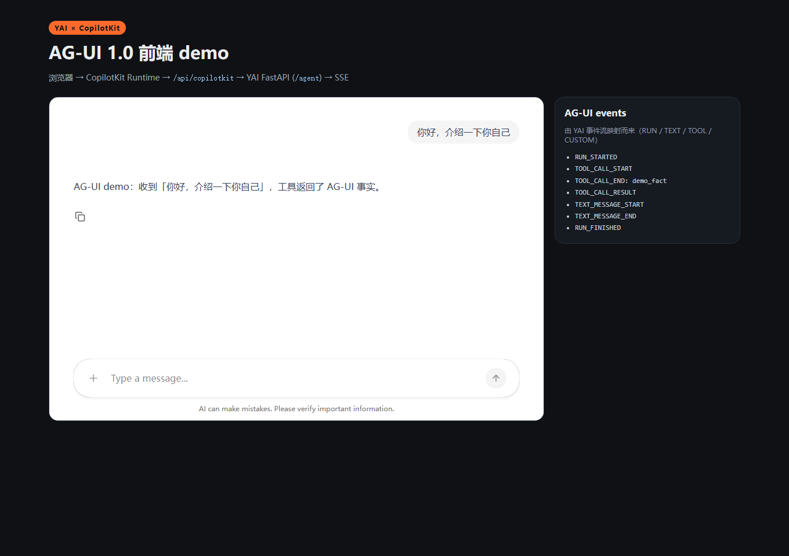

> English translation of [中文](README.md) · The Chinese version is canonical; if they disagree, the Chinese wins.

# host_ag_ui_copilotkit · real CopilotKit frontend

**English** · [简体中文](README.md)

Render YAI's AG-UI 1.0 event stream with **real CopilotKit (v2)**:

```
browser (CopilotChat)
  → CopilotKit Runtime (/api/copilotkit)
  → HttpAgent
  → YAI FastAPI (/agent, AG-UI SSE)
```



## Prerequisites

- Node.js ≥ 20 (verified on Node 24)
- The repo venv (`.venv`) with the `[server]` extra (FastAPI + uvicorn)

## Run

```bash
# Terminal A: the YAI AG-UI SSE host (offline ScriptedModel, no key)
uv sync --extra server
uv run uvicorn examples.host_ag_ui_sse.app:app --host 127.0.0.1 --port 8000

# Terminal B: CopilotKit runtime + frontend
cd examples/host_ag_ui_copilotkit
npm install
npm run build
npm start          # http://127.0.0.1:4000
```

Open <http://127.0.0.1:4000>, send a message, and watch CopilotChat reply while the
`AG-UI events` panel shows `RUN_STARTED / TOOL_CALL_* / TEXT_MESSAGE_* / RUN_FINISHED`
(the example really calls a local `demo_fact` tool once).

Development mode (Vite HMR):

```bash
node server.mjs          # runtime :4000
npm run dev              # frontend :5173 (/api proxied to :4000)
```

## Local verification (2026-11-14)

- `/api/copilotkit/info` returns `mode: sse` and agent `default`;
- sending "你好，介绍一下你自己" yields the reply "AG-UI demo：收到…";
- the event panel shows `RUN_STARTED / TEXT_MESSAGE_START / TEXT_MESSAGE_END / RUN_FINISHED`;
- screenshot: `docs/assets/copilotkit-demo.png`.

## Boundaries

- Local demo only: `ScriptedModel`, single user, `identifyUser` pinned to a demo user;
- Not production: no login, tenant isolation, or Copilot Cloud integration;
- Uses CopilotKit `@copilotkit/runtime@1.87.1` / `@copilotkit/react-core@1.87.1` v2 APIs
  (`CopilotRuntime` + `createCopilotEndpointExpress` + `CopilotKitProvider`);
- The frontend bundle is large (CopilotKit UI ships code highlighting/Mermaid etc.); demo only.
