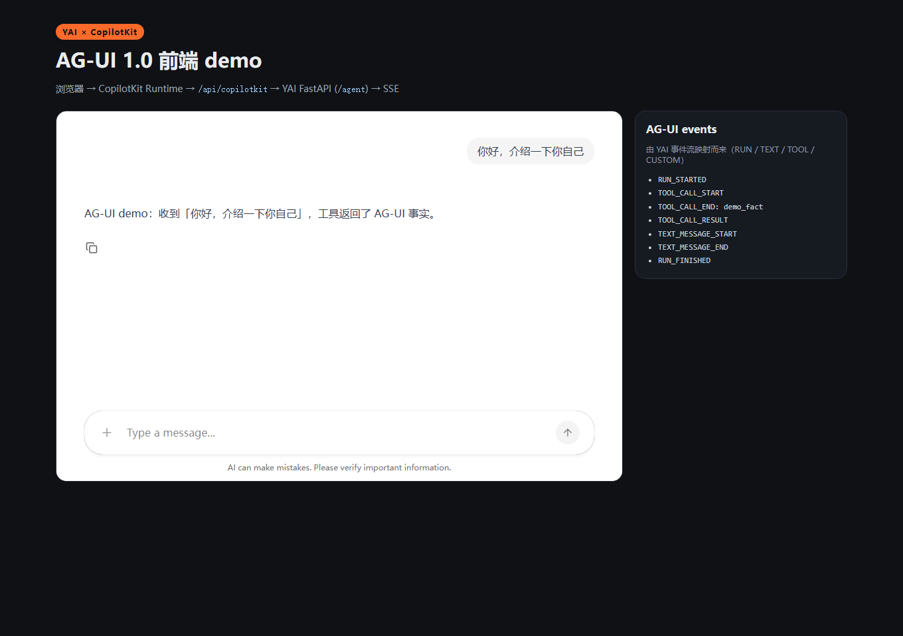

# host_ag_ui_copilotkit · 真实 CopilotKit 前端

[English](README.en.md) · **简体中文**

用 **真实 CopilotKit（v2）** 渲染 YAI 的 AG-UI 1.0 事件流：

```
浏览器 (CopilotChat)
  → CopilotKit Runtime (/api/copilotkit)
  → HttpAgent
  → YAI FastAPI (/agent, AG-UI SSE)
```



## 前置

- Node.js ≥ 20（本机验证：Node 24）
- 仓库 venv（`.venv`）已安装 `[server]` extra（FastAPI + uvicorn）

## 运行

```bash
# 1) 终端 A：YAI 的 AG-UI SSE 宿主（离线 ScriptedModel，零 Key）
uv sync --extra server
uv run uvicorn examples.host_ag_ui_sse.app:app --host 127.0.0.1 --port 8000

# 2) 终端 B：CopilotKit runtime + 前端
cd examples/host_ag_ui_copilotkit
npm install
npm run build
npm start          # http://127.0.0.1:4000
```

打开 <http://127.0.0.1:4000>，输入一句话即可看到 CopilotChat 的回复，右侧
`AG-UI events` 面板显示 `RUN_STARTED / TOOL_CALL_* / TEXT_MESSAGE_* / RUN_FINISHED`
（示例会真实调用一次本地 `demo_fact` 工具）。

开发模式（Vite HMR）：

```bash
node server.mjs          # runtime :4000
npm run dev              # 前端 :5173（/api 代理到 :4000）
```

## 本机验证记录（2026-11-14）

- 浏览器 → `/api/copilotkit/info` 返回 `mode: sse`、agent `default`；
- 发送「你好，介绍一下你自己」→ 回复「AG-UI demo：收到…」；
- 事件面板出现 `RUN_STARTED / TEXT_MESSAGE_START / TEXT_MESSAGE_END / RUN_FINISHED`；
- 截图见 `docs/assets/copilotkit-demo.png`（上述运行截图）。

## 边界

- 本地 demo：`ScriptedModel` 离线模型、单用户、`identifyUser` 固定为 demo 用户；
- 不是生产部署：没有登录、租户隔离、Copilot Cloud 集成；
- 依赖 CopilotKit `@copilotkit/runtime@1.87.1` / `@copilotkit/react-core@1.87.1` 的 v2 API
  （`CopilotRuntime` + `createCopilotEndpointExpress` + `CopilotKitProvider`）；
- 前端打包体积较大（CopilotKit UI 自带代码高亮/Mermaid 等），仅作 demo。
