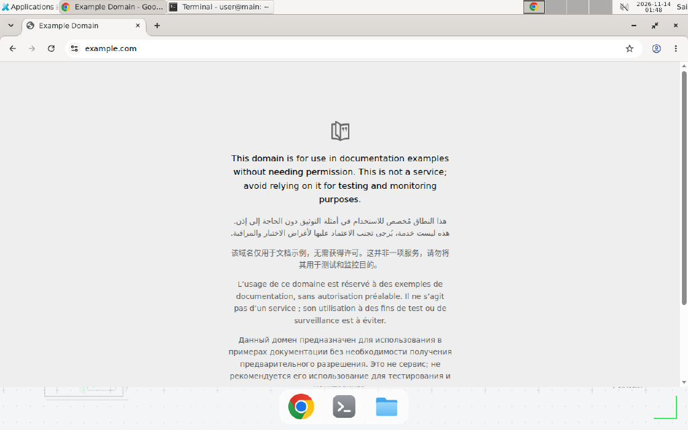

> English translation of [中文](README.md) · The Chinese version is canonical; if they disagree, the Chinese wins.

# host_box_mcp · Box by Simular real-machine smoke

**English** · [简体中文](README.md)

[Box by Simular](https://box.simular.ai/) is a cloud desktop (Ubuntu + Chrome + shell) that exposes
`shell` / `browser_*` / `computer_*` tools over MCP. This example proves **Box is just another MCP
server**: YAI's existing `McpToolBridge` connects to it directly.



## 1. Create a personal key

1. Sign in at <https://box.simular.ai/>;
2. Open <https://box.simular.ai/access> → **Keys and devices** → **Create key**;
3. Name it (e.g. `yai-agent-core`) and copy the `cb_...` value (shown once);
4. Put it in the repo-root `.env.local` (ignored by `.gitignore`'s `*.local`):

```bash
BOX_TOKEN=cb_...
```

## 2. Run

```bash
uv sync --extra mcp
uv run python examples/host_box_mcp/smoke.py          # status -> wake -> shell -> Chrome
uv run python examples/host_box_mcp/smoke.py --json
```

Verified locally (2026-11-14):

```text
Box MCP tools : 37
box_id        : cb-f4...
state         : absent -> running
image         : sbxdesk:v22
shell         :
  hello-from-box
  Linux main 6.8.0-142-generic x86_64 GNU/Linux
  /workspace
browser       : Page: Example Domain (https://example.com/)
```

The same bridge also registers `browser_snapshot` / `browser_click` / `screenshot` /
`computer_act` / `gui_plan` and 37 tools in total — the host (`AgentCore`) sees only uniform
`ToolSpec`s, exactly like local functions.

## 3. Full computer-use acceptance

```bash
uv run python examples/host_box_mcp/acceptance.py
```

Verified locally (2026-11-14), all PASS:

- **A read**: `box_status` running (`sbxdesk:v22`) + `computer_state` sees the Xfce windows;
- **B GUI write**: `computer_act` types `echo box-gui-ok > /workspace/gui-proof.txt` in the Box
  terminal, then `read_file` returns `box-gui-ok` (screen input -> file content);
- **C browser write**: local form -> `browser_navigate` -> `browser_type` / `browser_click` ->
  `browser_read` returns `hello YAI`;
- **D cleanup**: `shell` removes the acceptance files.

> Browser windows are scoped to the MCP session: all of C must run on one `McpToolBridge`
> connection.

## 4. Honest boundaries

- The personal key lives only in local `.env.local`; it is never committed or echoed. Revoke it from
  the Access page if leaked;
- Box Free shows `0 credits left`: this example uses only the box shell/Chrome (not Box's models);
  billing is authoritative on the Box billing page;
- This verifies "MCP connection + shell + browser navigation", not a full Side Panel / desktop GUI
  acceptance;
- `box_ensure` wakes or creates a box and may take tens of seconds; use `--no-wake` to avoid it.
