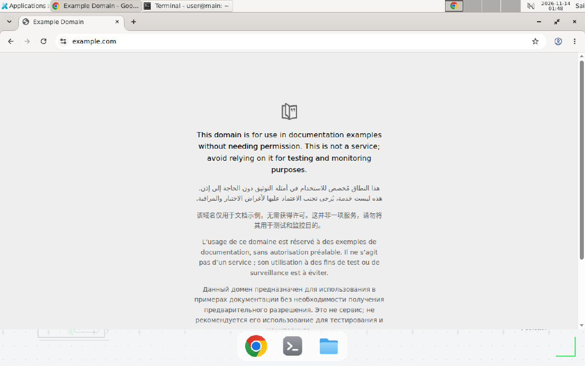

# host_box_mcp · Box by Simular 真机冒烟

[English](README.en.md) · **简体中文**

[Box by Simular](https://box.simular.ai/) 是一个云桌面（Ubuntu + Chrome + shell），
通过 MCP 暴露 `shell` / `browser_*` / `computer_*` 等工具。本示例证明：**Box 只是
一个普通 MCP Server**，用 YAI 已有的 `McpToolBridge` 即可直接接入。



## 1. 创建个人 key

1. 登录 <https://box.simular.ai/>；
2. 打开 <https://box.simular.ai/access> → **Keys and devices** → **Create key**；
3. 名称随意（如 `yai-agent-core`），复制 `cb_...`（只显示一次）；
4. 写入仓库根 `.env.local`（已被 `.gitignore` 的 `*.local` 忽略）：

```bash
BOX_TOKEN=cb_...
```

## 2. 运行

```bash
uv sync --extra mcp
uv run python examples/host_box_mcp/smoke.py          # 状态 → 唤醒 → shell → Chrome
uv run python examples/host_box_mcp/smoke.py --json
```

本机实测（2026-11-14）：

```text
Box MCP tools : 37
box_id        : cb-f4...
state         : absent -> running
image         : sbxdesk:v22
shell         :
  hello-from-box
  Linux main 6.8.0-142-generic x86_64 GNU/Linux
  /workspace
browser       : Page: Example Domain (https://example.com/)
```

同一 Bridge 里还注册了 `browser_snapshot` / `browser_click` / `screenshot` /
`computer_act` / `gui_plan` 等 37 个工具——宿主（AgentCore）看到的只是统一
`ToolSpec`，和本地函数没有区别。

## 3. 完整电脑操作验收

```bash
uv run python examples/host_box_mcp/acceptance.py
```

本机实测（2026-11-14）全部 PASS：

- **A 读**：`box_status` running（`sbxdesk:v22`）+ `computer_state` 读到 Xfce 窗口；
- **B GUI 写**：`computer_act` 在 Box 终端键入 `echo box-gui-ok > /workspace/gui-proof.txt`，
  再用 `read_file` 读到 `box-gui-ok`（屏幕输入 → 文件内容）；
- **C 浏览器写**：本地表单 → `browser_navigate` → `browser_type` / `browser_click` →
  `browser_read` 读出 `hello YAI`；
- **D 清理**：`shell` 删除验收文件。

> 浏览器窗口按 MCP 会话隔离：C 的所有动作必须在同一个 `McpToolBridge` 连接内。

## 4. 诚实边界

- 个人 key 只存本地 `.env.local`，不提交、不回显；泄露就回 Access 页 **Revoke**；
- Box Free 账户显示 `0 credits left`：本示例只用 box 的 shell/Chrome（不调 Box 的模型），
  是否计费以 Box 账单页为准；
- 本示例只验证「MCP 连接 + shell + 浏览器导航」，不是完整的 Side Panel / 桌面 GUI 验收；
- `box_ensure` 会唤醒或创建 box，首次可能需要几十秒；不想动 box 用 `--no-wake`。
